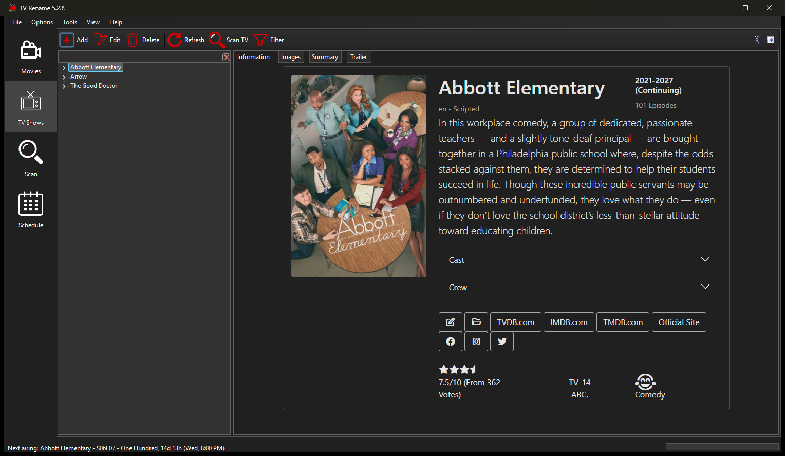
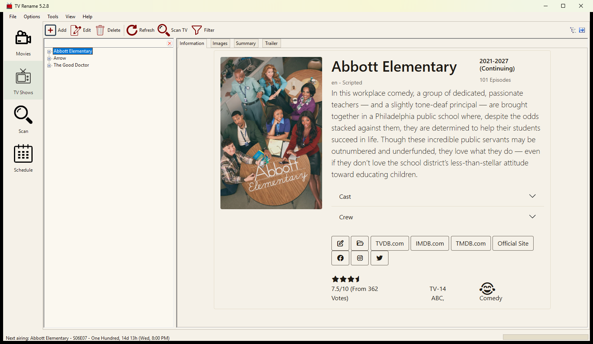
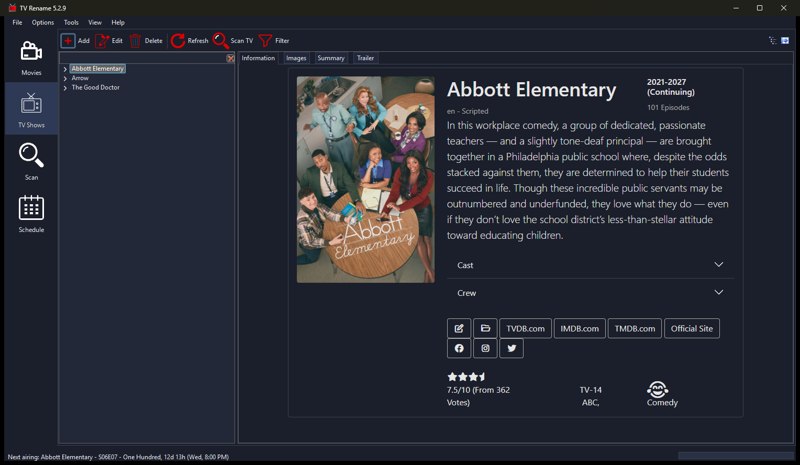

# Display / View

## Column Sorting, Filtering and Grouping

For the main tables of data:

* Schedule List
* Scan Results List
* Recommendations View
* (and many others)

The lists have the ability to be filtered, grouped and sorted in any custom way. If you right click on any menu header you can cusomise the way it is displayed:

* Filtering - Remove rows that match certain values from the list
* Sorting - order the list by any field
* Grouping - arrange the list items into groups based on a one column
* Column Chooser - remove/add columns from the view

<figure><figcaption></figcaption></figure>

## Themes

TV Rename can use a colour theme instead of its standard light look. Choose one from **Theme** on the [Display](../menu/preferences/display.md) tab of **Options>Preferences** and click `OK`. TV Rename tells you the theme will be used the next time it starts.

<figure><figcaption>
Dark
</figcaption></figure>

<figure><figcaption>
Creme
</figcaption></figure>

<figure><figcaption>
Midnight
</figcaption></figure>

### The themes in the list

| **Same as Windows (default)** | **Dark** when Windows is set to dark mode, **Light** when it isn't. TV Rename checks when it starts. |
| ----------------------------- | ---------------------------------------------------------------------------------------------------- |
| **Light**                     | TV Rename's standard look.                                                                           |
| **Dark**                      | Windows' dark look, with the parts that Windows leaves light or hard to read coloured to match.      |
| **Creme**                     | Warm creme colours on the standard light look.                                                       |
| **Midnight**                  | Deep midnight blue colours on Windows' dark look.                                                    |

Themes you make yourself (see below) are listed too, after **Dark**, in alphabetical order with **Creme** and **Midnight**.

### Theme files

Each theme is a file ending in **.theme.xml** in the **Themes** folder, which is inside the folder that holds your settings (see [Logs & Configuration Files](../technical/logs-and-configuration.md#configuration-files)). **Folder** next to **Theme** opens it.

When TV Rename starts, it creates the Themes folder if needed, with **Dark.theme.xml**, **Creme.theme.xml** and **Midnight.theme.xml** in it. If you delete one of them, the original comes back the next time TV Rename starts. If you already have a theme file with one of these names, TV Rename leaves it as it is and lists it by the name inside it. The Themes folder also has two folders of its own:

* **Defaults** – the original Dark, Creme and Midnight theme files. TV Rename puts these back every time it starts, so any change made to them is lost.
* **Backups** – for each theme you have used, the last copy that loaded without mistakes.

**Same as Windows** uses your **Dark.theme.xml**, so changes you make to it show there too.

### Making your own theme

1. Click **Folder** next to **Theme** to open the Themes folder.
2. Copy **Dark.theme.xml** or **Midnight.theme.xml** for a dark theme, or **Creme.theme.xml** for a light one, and give the copy a new name ending in **.theme.xml**, for example **MyTheme.theme.xml**.
3. Open the copy in a text editor such as Notepad. On the `<Theme ...>` line, change **name** to the name you want to see in the list, then change the colours you want.
4. Open **Options>Preferences** again, choose your theme from **Theme** on the Display tab, click `OK` and restart TV Rename.

Changes to the theme you are using also show the next time TV Rename starts.

In a theme file:

* **base="Dark"** builds the theme on Windows' dark look, **base="Light"** on the standard light look. If base is left out, Dark is used.
* Each colour has its own line, with a note above it saying what it colours. A colour can be written as **#RRGGBB** (for example #1E1E2E), as **#RGB**, as **R, G, B** (for example 30, 30, 46) or as a colour name (for example SteelBlue).
* Leave a value empty, or delete its line, to use the default colour for the base.

The colours a theme can set:

| **Background**         | Background of windows, dialogs and panels.                                                                                                       |
| ---------------------- | ------------------------------------------------------------------------------------------------------------------------------------------------ |
| **Text**               | Normal text on the Background colour.                                                                                                            |
| **ListBackground**     | Background of lists, trees, grids and text boxes.                                                                                                |
| **ListText**           | Text in lists, trees, grids and text boxes.                                                                                                      |
| **SecondaryText**      | Less important text, for example the messages under the scan progress bars.                                                                      |
| **DisabledText**       | Text of items that are switched off, for example scan steps that will not run.                                                                   |
| **Border**             | Borders of tab strips, column headers and progress bars.                                                                                         |
| **TabStrip**           | Tabs that are not selected.                                                                                                                      |
| **SelectedSideTab**    | The selected tab in the side tab strips (main window, Preferences).                                                                              |
| **HeaderBackground**   | Column and row headers of lists and grids.                                                                                                       |
| **HeaderHot**          | A column header under the mouse.                                                                                                                 |
| **HeaderPressed**      | A column header while it is clicked.                                                                                                             |
| **GroupTitle**         | Group titles in lists (for example the groups in the Scan results).                                                                              |
| **CalendarTitle**      | Title bar and weekday names of the calendar on the Schedule tab. The weekday names sit on the ListBackground colour, so keep the two well apart. |
| **ActiveFilterButton** | A filter button while its filter is switched on.                                                                                                 |
| **Warning**            | Background that flags a problem (an action with an error, a folder that does not exist).                                                         |
| **ScheduleToday**      | Schedule rows for episodes airing today.                                                                                                         |
| **ScheduleFuture**     | Schedule rows for episodes airing in the future.                                                                                                 |
| **SchedulePast**       | Schedule rows for episodes that have aired.                                                                                                      |
| **ScheduleText**       | Text on the three Schedule row colours.                                                                                                          |
| **ProgressBar**        | The filled part of progress bars.                                                                                                                |
| **ProgressTrack**      | The empty part of progress bars.                                                                                                                 |
| **WebText**            | Text on the Information, Images and Summary pages.                                                                                               |
| **WebMutedText**       | Small, less important text on those pages (episode counts, dates).                                                                               |
| **WebLink**            | Links on those pages.                                                                                                                            |
| **WebBorder**          | Table lines and borders on those pages.                                                                                                          |
| **WebSeasonRow**       | The season heading rows in the Summary page tables.                                                                                              |

### If a theme has a mistake

If the theme you chose has a mistake, TV Rename shows a message saying what is wrong once its main window has opened, and writes it to the log:

* A colour TV Rename can't read, or a line that isn't one of the colours above, is ignored, and that colour uses its default. The rest of the theme is used.
* If the file can't be used at all (for example it is not valid XML, base is something other than Dark or Light, or the file is missing), TV Rename uses the last copy from the **Backups** folder. If there isn't one, it uses the original Dark, Creme or Midnight theme, or else its standard light look.

When TV Rename is started with /hide or /unattended (see [Command Line](../technical/command-line.md)), the message isn't shown, but the problem is still written to the log.

In Preferences, a theme file TV Rename can't read is listed by its file name with "(has a mistake)" after it.

To undo changes to a theme, copy its file from **Backups** (the last copy that worked) or **Defaults** (the original Dark, Creme or Midnight) back over the theme file in the Themes folder.

## Move 'The' and others to the end of the names

1. Use **Move ‘The’ to the end of tv show/movie names** on the [Display](../menu/preferences/display.md) tab of **Options>Preferences** to switch this on and choose which words to move to the end, for example:
   1. **The** in English
   2. **Le**, **La** and **Les** in French
2. To put these words after the rest of the name in your library's folder and file names too, use the `{ShowNamePost}` tag:
   1. For file names, see [filename-template-editor.md](../menu/options-menu/filename-template-editor.md "mention")
   2. For folder names, see [library-folders.md](../menu/preferences/library-folders.md "mention")
3. Check that it works with [filename-processors.md](../menu/options-menu/filename-processors.md "mention").

## Custom Colouring

On the [display.md](../menu/preferences/display.md "mention") tab you can set rules that change the colour of a show's name depending on its show or season status. These colours override the theme colours.
