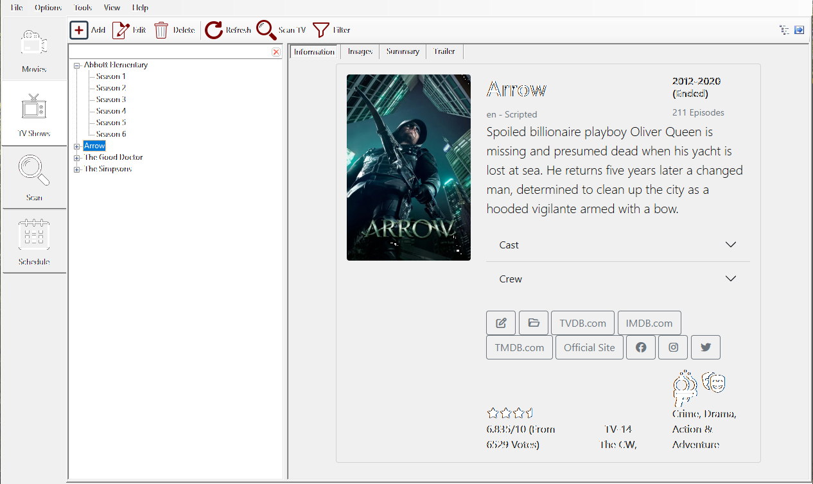
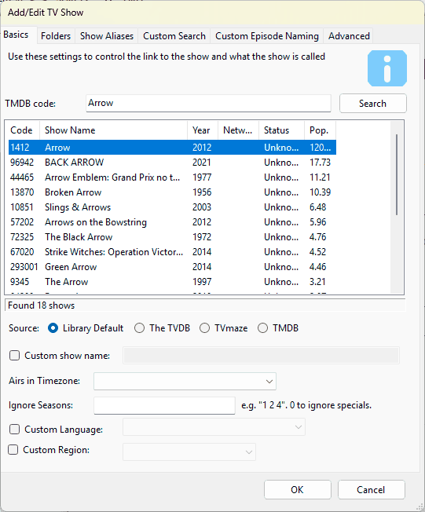

# TV Shows

The **TV Shows** tab displays a list of TV shows found and Identified in your media library, and is where you can manually tell TV Rename about a new TV show in the library, where it can be found and how it is structured.

## _TV Show Library_

In essence this tab (along with some of the [preferences](../menu/preferences.md)) allows you to configure the interaction between the [data sources](../help-and-support/data-sources.md) (TMDB, TheTVDB and TVmaze) and your media library. Incidentally there can be multiple storage locations including local paths or drives on your computer, mapped network shares and UNC paths. The only restrictions being that a TV show cannot be spread across multiple locations, and removable USB drives should be set up so they are always assigned the same path or drive letter each time they are connected.

<figure><figcaption></figcaption></figure>

Here, you can see a number of shows listed in the left hand panel of the window. These are the shows that TV Rename is monitoring, if a show is in your media library it will have further information associated with it (its “home” folder in the media library for example, but there is much more). In the right hand panel you can read details about the highlighted show gleaned from its data source.

There is a small “search filter” at the top of the Show List panel, typing in this box here will allow you to hide the display of shows that don’t match the text.

The right hand panel has four tabs:

* **Information** – details of the highlighted show or season. This is the usual setting.
* **Images** – all the cached images for a show or season of a show collected from its data source. Control of just what images are acquired is managed using the [_**Media Centres**_](../menu/preferences.md#the-media-centers-tab) tab of **Options>Preferences**.
* **Summary** – an overview of the show (or the highlighted season) with a table of its episodes.
* **Trailer** – an embedded YouTube viewer of the show’s trailer.

Below these panels are a series of buttons which allow you to manage the content. They are: -

* `Add` - Adds a new show to the list. Remember you may need to add folders for the show separately if you need to monitor it in the media library. You don’t need to add a folder if you only want to see the shows air-dates in the [**Schedule**](when-to-watch.md) tab.
* `Edit` - Edit the currently selected show or season.
* `Delete` - Remove the currently selected show(s) from TV Rename’s database, and optionally delete the selected show(s) from the media library - _**careful!**_
* `Hide Details` - Toggle between showing and hiding the (right hand) Information Panel. If the panel is hidden the Show List panel expands to fill the tab.
* `Collapse` - Toggle between a collapsed view of the Show List (just the show names) and an expanded view (show names, seasons and specials).
* `Refresh` - Refresh the current view
* `Scan TV` - Do a scan just for TV shows (ie no Movies)
* `Filter` - Filter the listed shows based on the entered criteria.
* `Context Menu` - Opens the same menu as right-clicking. This button is only shown when **Show Accessibility Options** is ticked on the [Display](../menu/preferences.md#the-display-tab) tab of **Options>Preferences**.

**REMEMBER:**

* Clicking on the `Add` button will open the _Add/Edit Show_ window ready to add another show.
* Clicking the `Edit` button with a **show** highlighted will open the same window pre-populated with that shows details.
* Clicking `Edit` with the **season** of a show highlighted will open the _Edit Season Rules_ window - [details](my-tv-shows.md#edit-season-rules)
* Right-clicking on a show (or season) will give you some custom options too, including
  * `Force Refresh` - Force TV Rename to delete the cached data it has about that show and refresh from the source
  * `Scan` followed by the show’s name - Do a scan just for this show.
  * `Episode Guide` and `Visit` followed by the data source (for example `Visit TMDB...`) - see the show (or season) in TV Rename or on the data source’s website.

## TV Show Configuration

### Add/Edit Show 

The _Add/Edit Show_ window has a number of tabs of its own, they are discussed below: -

#### The Basics Tab 

The “Basics” Tab is the starting point for telling TV Rename about a show you which to monitor.

The best way to illustrate this is with an example so lets add a show called “The Good Doctor” to TV Rename.

“Source:” chooses where TV Rename gets the show’s information. **Library Default** uses the **Default TV Show Source** on the [Data Sources](../menu/preferences.md#data-sources) tab of **Options>Preferences** (TMDB unless you have changed it). **The TVDB**, **TMDB** or **TVmaze** uses that source for this show only.

The first step is to tell TV Rename about the show. If you know it you can enter the show’s code at the data source (the box is labelled for the source, for example “TMDB code:”), otherwise type the shows name (e.g. “the good doctor”) and click on `Search`.

TV Rename will search for matches to your entry in the data source’s database, cache the results locally and display the matches. The search also works with partial show names. For example you could search for just “doctor”, but “doctor” being fairly common in TV show titles, returns many results (including ours!), and you will have to delve into the list to find the one you want. Once you have found the correct show, click on it to highlight it.

If all you want to do is see the details of the show then you’re done! Just click `OK` at the bottom of the window and TV Rename will pull the necessary data from the data source to populate the _**TV Shows**_ tab.

Once the update is complete _**TV Shows**_ includes “The Good Doctor” and looks like this: -

<figure><figcaption></figcaption></figure>

All the Show and Season information is downloaded and the _**Schedule**_ tab will now list any future episode dates, but there are no links to the media library.

Lets go back and tweak “The Good Doctor”. Assuming the show is listed in _**TV Shows**_, make sure it is highlighted and click `Edit` to recall the partially populated _Add/Edit Show_. If it isn’t listed in _**TV Shows**_ follow the steps above to get the show name populated and then carry on as described below.

The “Custom show name:” field allows you to change the show name in both TV Rename and the media library (except the base folder). You may like to remove “The” from names, or change extra information like the year the show was originally produced that appears with some shows. If you tick the box and enter a new name in the field provided the shows title will be replaced with this entry.

The “Airs in Timezone:” drop-down tells TV Rename that the air time from the data source is in that specific timezone. Time zones are listed by region and city, for example “America/New\_York” for Eastern USA time, which most shows use, and “Europe/London” for British shows (e.g. Maigret). This only has an effect in the _**Schedule**_ tab which translates these times into your local timezone, or in the status bar when calculating time till the “Next Airing:”.

_Default:_ _**the Airs in Timezone set on the**_ [_**TV Show Defaults**_](../menu/preferences.md#tv-show-defaults) _**tab of Options>Preferences (America/New\_York if none is set)**_

If you wish to ignore specific seasons of a show enter the season numbers (space separated) in the “Ignore Seasons:” field (Entering a “0” will ignore “Specials”).

_Default:_ _**Empty Field**_ (or “0” if **Ignore Specials** is ticked on the [TV Show Defaults](../menu/preferences.md#tv-show-defaults) tab)

The “Custom Language:” tick box and drop-down allows you to set a “non-default” language for the show in question. To activate it simply tick the box and select the preferred language for the show from the drop-down.

_Default:_ _**Un-ticked**_

The “Custom Region:” tick box and drop-down works the same way for the region TV Rename asks the data source for, instead of the **Preferred region** on the Data Sources tab.

_Default:_ _**Un-ticked**_

To complete the minimum setup for adding the show to the library we now need to go to the [“Folders” Tab](my-tv-shows.md#the-folders-tab).


**User Tip**

The search function of TheTVDB API is a bit flakey. I find it particularly has a problem with punctuation, but the main thing is that the API only returns exact matches, while when you do a search on the website itself you appear to get partial/fuzzy matches as well. (Mind you, there are times when searching on the web site is _worse_.) But sometimes it's worth doing a search on the website, finding the TheTVDB "code" for the show, and just entering that specifically into TVRename.

To do this, go into the details of the show and in the initial table the top line reads "TheTVDB.com Series ID". Enter the number next to this straight into the "TheTVDB code" box in TVRename, click Search, and a single result should be returned, being the show you wanted. Continue as normal from there.

When making use of the regular search function inside TVRename I find "less is more" - try searching for fewer words. Don't search for words that are acronyms, like "S.H.I.E.L.D." or "M.D.". I usually drop the " 's " (apostrophe of possession and "s") at the end of words too, as that often gets better results, or I drop the words altogether. (e.g. Is the show under "Agatha Christie's Poirot" or just under "Poirot" in the database?) Ultimately, often it's a trade-off between getting a bunch of results where you have to scroll to then find the one you want, and getting no results at all.

_-Michael_


#### The Folders Tab 

<figure><figcaption></figcaption></figure>

Completing the “Folders” Tab tells TV Rename about the library folder for the show. Returning to our example of “The Good Doctor”: -

If the “Automatic Season Folders” box is ticked the path to the “Base Folder” can be typed in the text box or filled in by browsing, or click `Create...` to pick one of your library folders and a folder name for the show. Either way, now TV Rename knows the location of the shows base folder in the media library all the “really useful” stuff can begin!

The three radio buttons determine how the seasons of the show are handled: -

Selecting “Subdirectories (default)” will tell TV Rename to create a sub folder for each season, named with the **Seasons folder format** on the [Library Folders](../menu/preferences.md#the-library-folders-tab) tab of **Options>Preferences** (“Season 01”, “Season 02”, “Season 03” etc. by default).

Selecting “Store all seasons in Base Folder” will tell TV Rename to store all the related files in the base folder specified previously.

Selecting “Custom Subdirectories” allows you to specify (using text and tags) the naming of the season folders. Click `Tags...` to see the tags you can use.

| _**Default:**_ | “Subdirectories (default)” | _**Selected**_ |
| -------------- | -------------------------- | -------------- |

If you require more granular control you can un-tick the “Automatic Season Folders” option and use the “Manual/Additional Folders” entries to specify the exact name and location for each season folder used by the show.

The “Manual/Additional Folders” section allows you to manually add and remove additional Seasons and associated folders. Tick “Replace Automatic Season Folders” to have a season’s manual folder used instead of its automatic folder, rather than as well as it.

#### The Show Aliases Tab

<figure><figcaption></figcaption></figure>

The Show Aliases tab only affects source files, it does **not** affect show episodes in your media library (TV Rename can work out the correct name for a file in the library from the containing folder structure and the show/season number).

Sources often rename files because of the excessive length of the shows name, for example “Law and Order- Special Victims Unit” could be represented as “L\&O-SVU”. Adding “L\&O-SVU” as an alias would cause any source file with that abbreviated name be renamed correctly when moved or copied into the library.

Another good example (though for different reasons) would be the BBC1 show “Doctor Who”, the data sources correctly call it “Doctor Who” which TV Rename will recognise, however some sources variously call the show “Dr. Who” or “Dr Who” causing some confusion. Adding “Dr. Who” and “Dr Who” as aliases for “Doctor Who” will fix this problem and everything will be correctly named “Doctor Who” when moved or copied into the library.

**Source Aliases** lists the other names the data source has for the show; TV Rename uses these as well. Your own aliases go in **Custom Aliases**.

#### The Custom Search Tab 

<figure><figcaption></figcaption></figure>

The Search Tab allows you to create a custom search for files on a per show basis.

This is useful if you collect episodes of a show that falls outside the scope of the “general” search engines and has its own genre-specific sites and searches (Japanese Anime for example).

Using the same technique and tag structure as found in [Options>TV Show Search Engines](../menu/options-menu/search-engines.md) you can create a search specific to the show without affecting the “general” searches.

This option is disabled by default but it can be enabled for the specific show by ticking the “Use Custom Search” box in the tab.

#### Custom Episode Naming Tab

This tab lets one show name its episode files differently from the rest of your library.

Normally every episode file is named with the template set in [Options>Filename Template Editor](../menu/options-menu/filename-template-editor.md). To use a different name for this show’s episodes, tick **Use Custom Naming Format** and type the whole file name you want into **Custom Format**, using the tags listed under **Available Tags**. Leave out the file extension: TV Rename keeps each file’s own extension.

Once there is a custom format, **Default** shows an episode of this show named with your library template and **Example** shows the same episode named with your custom format, so you can compare them. **Available Tags** lists each tag with its value for that episode.

For example, the custom format `{ShowName} - S{Season:2}E{Episode} - {EpisodeName}` names episode 6 of season 1 of The Outpost `The Outpost - S01E06 - The Book of Names`.

The custom format is used when **Do renaming** is ticked on the [Advanced tab](my-tv-shows.md#the-advanced-tab). Untick **Use Custom Naming Format** to go back to your library template.

#### The Advanced Tab 

Here, you can further manipulate the way data from the data source is handled as it is merged into the local data. New shows start with the ticks set in **Default Advanced Settings** on the [TV Show Defaults](../menu/preferences.md#tv-show-defaults) tab of **Options>Preferences**.

The “Use DVD Order” tick box comes into play when the episodes aired on TV in a different order to those presented on the DVD. [The TVDB](http://thetvdb.com/) usually has details of these orders and this tick box allows you to choose your preference for the current show. A Really good example of this is the 1967 ITV show [“The Prisoner”](https://www.thetvdb.com/?tab=season\&seriesid=74805\&seasonid=8058\&lid=7), which, whilst it was written as one season of seventeen episodes still causes as much controversy (and argument) over it’s running order today as it did when it was originally released. TVDB also has an 'alternate order' specified as some shows have had episodes regrouped into seasons on different platforms; tick “Use Alternate Order” to use it. “Use DVD Order” and “Use Alternate Order” can’t both be ticked.

The “Show next airdate in 'Schedule'” tick box toggles the display of the shows “Returning Series” and “Other Planned Episodes” in the _**Schedule**_ tab.

The “Specials count as episodes” tick box is useful with shows such as “Mythbusters” where specials are often counted as normal episodes.

The “Do Renaming” tick box tells TV Rename to use the names built using the [_**Options>Filename Template Editor**_](../menu/options-menu/filename-template-editor.md) when copying or moving files if it is ticked, otherwise they will be left unchanged.

The “Do missing check” tick-box enables or disables the ability to check for missing episodes, if the option is ticked some degree of granularity is provided by the “Include future episodes” and “Include no airdate” tick-boxes.

Under “When finding missing episodes (only)” are three more ways of matching a file to an episode:

“Use sequential number matching” will match episodes based on their overall airing order. Because this can cause a large number of false matches, the box is un-ticked by default.

For example, Season 4 Episode 9 of Marvel’s Agents of S.H.I.E.L.D. is the 75th episode aired, so with this option enabled “Marvel’s Agents of S.H.I.E.L.D. - 75 - Broken Promises.mkv” will be seen at S04E09.

“Look for airdate in filenames” matches a file to an episode by an air date in the file name.

“Look for episode title in filenames” matches a file to an episode by the episode’s title in the file name.

### Edit Season Rules 

The “Edit Season Rules” pane allows you to manipulate the local data from the data source to suit your episode structure.

<figure><figcaption></figcaption></figure>

Episodes 1 and 2 of Season 5 of “Marvel’s Agents of S.H.I.E.L.D.” aired as a double episode so only one file exists, however the data source correctly has both episodes listed individually, so there is a conflict.

The image illustrates a rule that merges the two episodes into one. This will affect the name displayed in the _**TV Shows**_ tab, and the naming of the file in the media library.

The rules are applied in top to bottom order, you can use the the `Up` and `Down` buttons to move a rule.

`Add`, `Edit`, and `Delete` will manipulate the list as expected.

<figure><figcaption></figcaption></figure>

Clicking either `Add` or `Edit` will open the _Add/Modify Rule_ pane. The only difference being `Add` allows you to create a new rule and `Edit` pulls in the data from a highlighted rule for you to change.

In this example we are editing the rule shown above. This is a two part process, firstly select an “Action:”, and secondly tell TV Rename what to apply the action to.

In this case the “Action” is “Merge”, we are merging “1” and “2” i.e. Episodes 1 and 2 of the selected season, And we will let TV Rename name the new file automatically.

The “Actions:” available are: -

| **Ignore**   | Keep the specified episode in the guide, but don’t check for it (or rename it) on disk locally.   |
| ------------ | ------------------------------------------------------------------------------------------------- |
| **Rename**   | Manually set the name of an episode.                                                              |
| **Remove**   | Make a an episode disappear. All episodes above will be renumbered down to fill the gap.          |
| **Swap**     | Swap the position of two episodes.                                                                |
| **Merge**    | The episodes numbers supplied all in a single multi-episode file.                                 |
| **Insert**   | Manually add an episode into the season. Later episodes are renumbered to accommodate the change. |
| **Split**    | Turn one episode into many. Following episodes are renumbered to accommodate the change.          |
| **Collapse** | Merge the episodes into one episode with a single episode number.                                 |

Tick “Renumber Season After Action” to have the season’s episodes numbered again in order once the rule has been applied.

After applying a rule, go to _**TV Shows**_ , select the show, and click `Refresh`. You will then see (and can check) the effects of the rules you’ve created.

## Auto Add Shows 

Whilst discussing “Add/Edit Shows” it would be remiss not to mention “Auto Add Shows”.

This not-so-obvious trick in TV Rename’s functionality attempts to add video files that have been downloaded but are unknown to TV Rename to its database for inclusion in the library.

It is activated by ticking the **Notify when new media is found** box on the [Search Folders](../menu/preferences.md#the-search-folders-tab) tab of **Options>Preferences**.

For example: -

If the show file “Westworld.S01E01.HDTV.x264.mp4” exists in the downloads directory but **not** in TV Rename’s database and the **Notify when new media is found** box is ticked; a scan will result in the following pop-up appearing…

<figure><figcaption></figcaption></figure>

TV Rename has taken it upon itself to attempt to find the show name and look it up using its data sources! The window has a **TV Shows** tab and a **Movie** tab, each with a “Source:” choice like the one on the Basics tab.

You now have a number of options: -

Selecting `Skip Auto Add` stops doing auto add for this scan for all files.

Selecting `Ignore File Forever` stops doing auto add on that file for this (and all future) scans.

Selecting `Leave for later` ignores this file for this scan.

However, if you select the matching series name in the central window (in this case “Westworld”) the “Location:” will be modified to include the show name. Click `Quick Add` and the file will be added to the library, prompting you to create the required sub-directories as necessary.

Auto Add uses the default settings for almost all options (so the timezone etc. may be need adjusting).

The “Location:” list holds your library folders from the [Library Folders](../menu/preferences.md#the-library-folders-tab) tab of **Options>Preferences**.

## Seen Episodes

TV Rename keeps a list of the episodes it has seen in your library. An episode is added to the list when a scan finds its video file correctly named in the right place, or when TV Rename copies, moves or renames a video file into place for it.

If **Ignore Episodes Previously Seen** is ticked on the [Scan Settings](../menu/preferences.md#scan-settings) tab of **Options>Preferences**, episodes on this list are no longer reported as missing, even after their file has gone from your library. This is useful if you delete episodes once you have watched them.

To see or change the list for a season:

1. In the **TV Shows** tab, select the season and click `Edit`, or right-click the season and choose **Edit Season** followed by its number.
2. In the **Edit Season** window, open the **Library Episodes** tab. It lists the season's seen episodes, with their **Episode** number and **Name**.
3. Click `Add` to mark another episode as seen. In the **New Seen Episode** window, pick the episode under "Select an episode that should be considered 'seen':" and click `OK`.
4. To take episodes off the list, select them and click `Remove`.
5. Click `OK` to save your changes, or `Cancel` to leave the list as it was.

The **Rules** tab of the same window is described in [Edit Season Rules](my-tv-shows.md#edit-season-rules).
