# Preferences

Open Preferences with **Options>Preferences**. Each tab is described below, in the order the tabs appear in the window. The pictures show each tab with its default settings.

### General <a href="#the-general-tab" id="the-general-tab"></a>

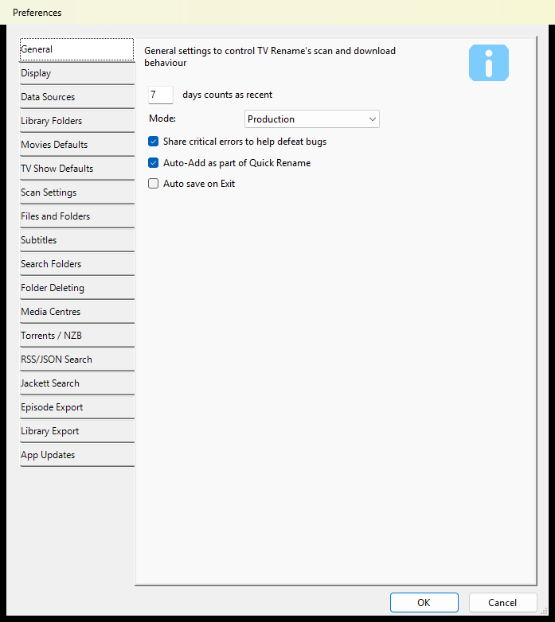

* **days counts as recent** – how many days count as “recent”. It sets how many days are listed in the “Aired in the last N days” section of the [Schedule](../main/when-to-watch.md) tab, and which shows a **Recent** scan checks (see [Scan Settings](preferences.md#scan-settings)).
* **Mode** – **Production** or **Beta**. In **Beta** mode a [Beta](beta-menu.md) menu appears between **View** and **Help**, giving you a preview of features still being worked on, and TV Rename offers you Beta and RC (release candidate) updates as well as the normal releases.
* **Share critical errors to help defeat bugs** – lets TV Rename send anonymous crash details to the [SolarWinds Papertrail](https://papertrailapp.com/) log service, to help the developers fix bugs, as mentioned in the License Agreement (see **Help>About**).
* **Auto-Add as part of Quick Rename** – when [Tools>Quick Rename TV Files](tools-menu/quick-rename-tv.md) is given a file for a show that isn’t in TV Rename yet, TV Rename looks the show up and adds it.
* **Auto save on Exit** – when ticked, TV Rename saves your changes when you close it. When un-ticked, it asks you whether to save them.

_Defaults: **7** days, **Production**, **Share critical errors** ticked, **Auto-Add as part of Quick Rename** ticked, **Auto save on Exit** un-ticked._

### Display <a href="#the-display-tab" id="the-display-tab"></a>

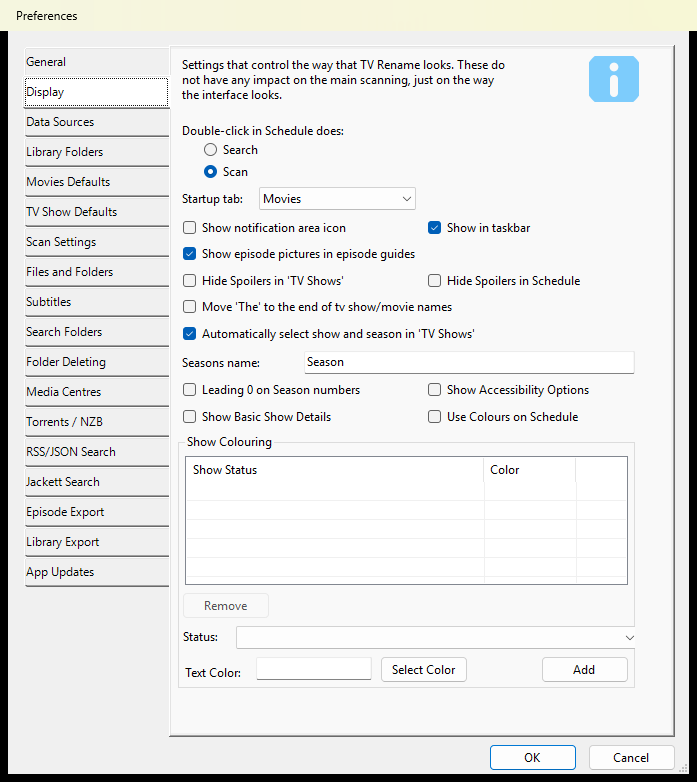

The Display tab changes how TV Rename looks. It doesn’t change what scans do.

* **Double-click in Schedule does** – what double-clicking an episode on the [Schedule](../main/when-to-watch.md) tab does: **Search** or **Scan**.
* **Startup tab** – the tab TV Rename opens on: **Movies**, **TV Shows**, **Scan** or **Schedule**.
* **Show notification area icon** and **Show in taskbar** – where TV Rename’s icon appears. One of them must be ticked: if you un-tick both, the other one ticks itself again. With the notification area icon, right-clicking the icon shows a list of upcoming shows and double-clicking it brings back the main window. You can tick both.
* **Show episode pictures in episode guides** – shows a picture from each episode with its description on the [TV Shows](../main/my-tv-shows.md) tab. Un-ticked, only the description is shown.
* **Hide Spoilers in ‘TV Shows’** and **Hide Spoilers in Schedule** – hide the summaries of episodes that haven’t been shown yet on those tabs.
* **Move ‘The’ to the end of tv show/movie names** – lists “The Hollow Crown” as “Hollow Crown, The”, sorted with the other names starting with “H”. This only changes how names are listed in TV Rename, **not** the names of your files and folders.
* **Automatically select show and season in ‘TV Shows’** – when you select an episode on the Schedule or Scan tab, the TV Shows tab moves to that show and season.
* **Seasons name** and **Leading 0 on Season numbers** – the word, and the number style, used for seasons on the TV Shows tab.
* **Show Accessibility Options** – adds a **Context Menu** button to the TV Shows and Movies tabs, which opens the same menu as right-clicking.
* **Show Basic Show Details** – uses the older, simpler layout for the right-hand panel of the TV Shows tab. It can work better on small screens, slower PCs and slower internet connections.
* **Use Colours on Schedule** – colours the episodes on the Schedule tab by when they air.

**Show Colouring**

If you have a lot of shows, the list on the TV Shows tab can get cluttered. **Show Colouring** changes the colour of a show’s name in that list depending on the status of the show or season.

To add a rule:

* Choose the status to match from the **Status** drop-down.
* Type a colour name or code in **Text Color**, or click `Select Color` and pick one.
* Click `Add`. The rule appears in the list above.

For example, to make finished shows less noticeable, choose “Show Status: Ended”, type “#808080” in **Text Color** and click `Add`. Ended shows are then listed in grey.

To remove a rule, select it and click `Remove`.

_Defaults: double-click does **Scan**, Startup tab **Movies**, **Show in taskbar** ticked, **Show episode pictures in episode guides** ticked, **Automatically select show and season in ‘TV Shows’** ticked, Seasons name **Season**, everything else un-ticked, no colour rules._

### Data Sources <a href="#data-sources" id="data-sources"></a>

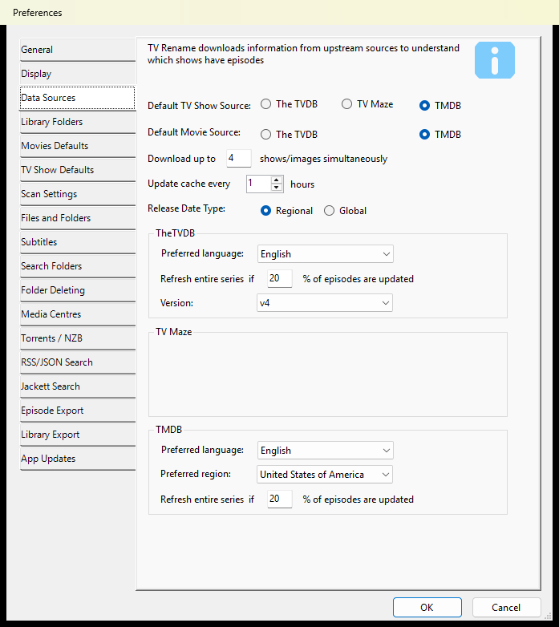

These settings control where TV Rename gets information about your TV shows and movies, and how it keeps that information up to date.

* **Default TV Show Source** – where TV Rename gets information about TV shows: The TVDB, TV Maze or TMDB. A show uses this source unless a different one is chosen in **Source** on the [Basics tab](../main/my-tv-shows.md#the-basics-tab) of Add/Edit Show.
* **Default Movie Source** – the same for movies: The TVDB or TMDB. A movie can use a different one, chosen in **Source** on the [Basics](../main/movies.md#basics) tab of Add/Edit Movie.
* **Download up to** … **shows/images simultaneously** – how many downloads TV Rename runs at the same time, from 1 to 8.
* **Update cache every** … **hours** – how often TV Rename refreshes its show and movie information in the background, from every hour to every 96 hours. This only happens while [Options>Automatic Background Download](options-menu/automatic-background-download.md) is ticked.
* **Release Date Type** – which release date TV Rename uses for movies. **Regional** uses the release date in your region: the movie’s own **Custom Region** if one is set, otherwise the **Preferred region** in the TMDB group below. **Global** uses the earliest release date anywhere.

**TheTVDB**

* **Preferred language** – the language TV Rename asks TheTVDB for.
* **Refresh entire series if** … **% of episodes are updated** – when at least this share of a show’s episodes have changed on TheTVDB, TV Rename downloads the whole show again rather than just the changed episodes.
* **Version** – the version of TheTVDB’s service that TV Rename uses (v4).

**TV Maze** has no settings.

**TMDB**

* **Preferred language** – the language TV Rename asks TMDB for.
* **Preferred region** – TMDB gives release dates and certifications for this region.
* **Refresh entire series if** … **% of episodes are updated** – the same as the TheTVDB setting above, for TMDB.

_Defaults: **4** downloads at a time, update every **1** hour, **Regional**, **20%**._

These settings control where TV Rename gets information about your TV shows and movies, and how it keeps that information up to date.

* **Default TV Show Source** – where TV Rename gets information about TV shows: The TVDB, TV Maze or TMDB. A show uses this source unless a different one is chosen in **Source** on the [Basics tab](../main/my-tv-shows.md#the-basics-tab) of Add/Edit Show.
* **Default Movie Source** – the same for movies: The TVDB or TMDB. A movie can use a different one, chosen in **Source** on the [Basics](../main/movies.md#basics) tab of Add/Edit Movie.
* **Download up to** … **shows/images simultaneously** – how many downloads TV Rename runs at the same time, from 1 to 8.
* **Update cache every** … **hours** – how often TV Rename refreshes its show and movie information in the background, from every hour to every 96 hours. This only happens while [Options>Automatic Background Download](options-menu/automatic-background-download.md) is ticked.
* **Release Date Type** – which release date TV Rename uses for movies. **Regional** uses the release date in your region: the movie’s own **Custom Region** if one is set, otherwise the **Preferred region** in the TMDB group below. **Global** uses the earliest release date anywhere.

**TheTVDB**

* **Preferred language** – the language TV Rename asks TheTVDB for.
* **Refresh entire series if** … **% of episodes are updated** – when at least this share of a show’s episodes have changed on TheTVDB, TV Rename downloads the whole show again rather than just the changed episodes.
* **Version** – the version of TheTVDB’s service that TV Rename uses (v4).

**TV Maze** has no settings.

**TMDB**

* **Preferred language** – the language TV Rename asks TMDB for.
* **Preferred region** – TMDB gives release dates and certifications for this region.
* **Refresh entire series if** … **% of episodes are updated** – the same as the TheTVDB setting above, for TMDB.

_Defaults: **4** downloads at a time, update every **1** hour, **Regional**, **20%**._

### Library Folders <a href="#the-library-folders-tab" id="the-library-folders-tab"></a>

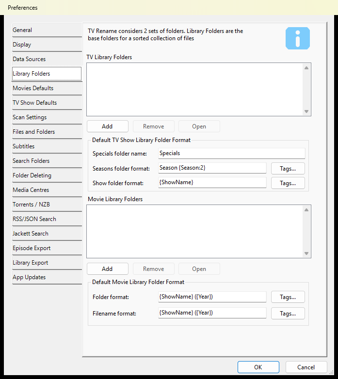

Library Folders tell TV Rename where your sorted collection is: where your TV show episodes and movies are kept **after** TV Rename has processed them. There is one list for TV shows and one for movies.

To add a library folder, click `Add` under the list, browse to the “base” folder of your library and click `OK`. Select a folder in the list and click `Remove` to remove it, or `Open` to see what is in it.

The “base” folder is the folder that holds all your show (or movie) folders:

```
  D:\                                      nas-1
  └─ media                                 └─ media
     └─ Video                                 └─ Video
        └─ TV Shows                              └─ TV Shows
           ├─ Show A                                ├─ Show C
           │  ├─ Season 1                           │  ├─ Season 1
           │  │  ├─ Episode 1                       │  │  ├─ Episode 1
           │  │  └─ Episode 2                       │  │  └─ Episode 2
           │  └─ Season 2                           │  └─ Season 2
           │     ├─ Episode 1                       │     ├─ Episode 1
           │     └─ Episode 2                       │     └─ Episode 2
           └─ Show B                                └─ Show D
              ├─ Season 1                              ├─ Season 1
              │  ├─ Episode 1                          │  ├─ Episode 1
              │  └─ Episode 2                          │  └─ Episode 2
              └─ Season 2                              └─ Season 2
                 ├─ Episode 1                             ├─ Episode 1
                 └─ Episode 2                             └─ Episode 2
```

For the folders above (left) the base folder is “D:\media\Video\TV Shows”. It can also be a network path (above right), for example “\\\nas-1\media\Video\TV Shows”.

**Default TV Show Library Folder Format**

* **Specials folder name** – the name of the folder for a show’s specials. Specials are usually numbered as season 0, so special 3 of “Battlestar Galactica” is “Battlestar Galactica - S00E03 - The Story So Far”, kept in the “Specials” folder.
* **Seasons folder format** – the name of each season’s folder. {Season} is replaced by the season number, and {Season:2} by a two-digit season number, so “Season {Season:2}” gives “Season 01”, “Season 02” and so on.
* **Show folder format** – the name of the folder TV Rename creates for a new show (see **Use Default Location** on the [TV Show Defaults](preferences.md#tv-show-defaults) tab).

**Default Movie Library Folder Format**

* **Folder format** – the name of each movie’s folder.
* **Filename format** – the name of each movie’s file.

The `Tags...` button next to each box lists the tags you can use in it.

These settings are useful if you want folder names in your own language.

_Defaults: Specials folder name **Specials**, Seasons folder format **Season {Season:2}**, Show folder format **{ShowName}**, movie Folder format and Filename format **{ShowName} ({Year})**._

### Movies Defaults <a href="#movies-defaults" id="movies-defaults"></a>

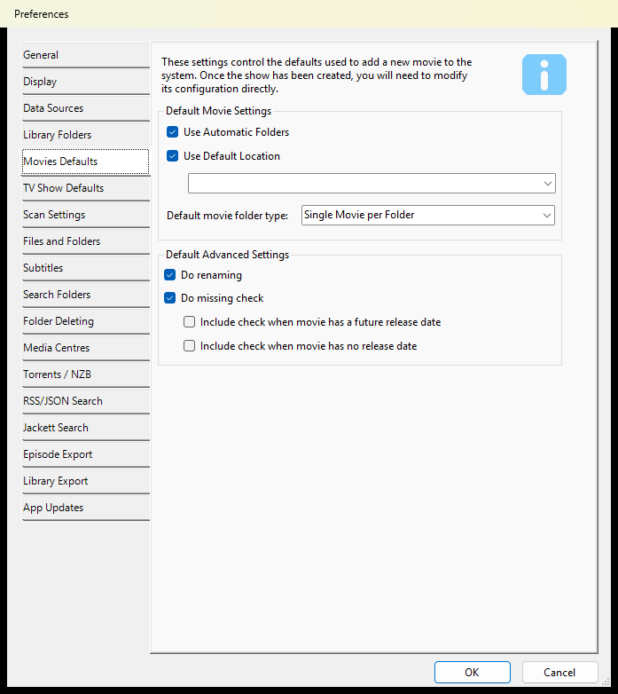

These settings are the starting values for each movie you add to TV Rename. Changing them doesn’t change movies that are already in TV Rename: edit those with `Edit` on the [Movies](../main/movies.md) tab, or use [Options>Settings Check](options-menu/settings-check.md) to find movies that differ from these defaults.

**Default Movie Settings**

* **Use Automatic Folders** – new movies have **Automatic Folders** ticked on the [Folders](../main/movies.md#folders) tab of Add/Edit Movie.
* **Use Default Location** – new movies go in the movie library folder chosen in the box under it. The box lists your **Movie Library Folders** from the [Library Folders](preferences.md#the-library-folders-tab) tab.
* **Default movie folder type** – the **Folder Type** a new movie starts with: Single Movie per Folder, Many Movies per Folder, DVD format or Bluray format. The [Folders](../main/movies.md#folders) tab of Add/Edit Movie explains each one.

**Default Advanced Settings** are the starting ticks for a new movie’s **Advanced** tab:

* **Do renaming** – TV Rename renames the movie’s files to match your naming settings.
* **Do missing check** – TV Rename reports the movie as missing when it can’t find its file.
  * **Include check when movie has a future release date** – also check movies that haven’t been released yet.
  * **Include check when movie has no release date** – also check movies that have no release date.

These settings are the starting values for each movie you add to TV Rename. Changing them doesn’t change movies that are already in TV Rename: edit those with `Edit` on the [Movies](../main/movies.md) tab, or use [Options>Settings Check](options-menu/settings-check.md) to find movies that differ from these defaults.

**Default Movie Settings**

* **Use Automatic Folders** – new movies have **Automatic Folders** ticked on the [Folders](../main/movies.md#folders) tab of Add/Edit Movie.
* **Use Default Location** – new movies go in the movie library folder chosen in the box under it. The box lists your **Movie Library Folders** from the [Library Folders](preferences.md#the-library-folders-tab) tab.
* **Default movie folder type** – the **Folder Type** a new movie starts with: Single Movie per Folder, Many Movies per Folder, DVD format or Bluray format. The [Folders](../main/movies.md#folders) tab of Add/Edit Movie explains each one.

**Default Advanced Settings** are the starting ticks for a new movie’s **Advanced** tab:

* **Do renaming** – TV Rename renames the movie’s files to match your naming settings.
* **Do missing check** – TV Rename reports the movie as missing when it can’t find its file.
  * **Include check when movie has a future release date** – also check movies that haven’t been released yet.
  * **Include check when movie has no release date** – also check movies that have no release date.

### TV Show Defaults <a href="#tv-show-defaults" id="tv-show-defaults"></a>

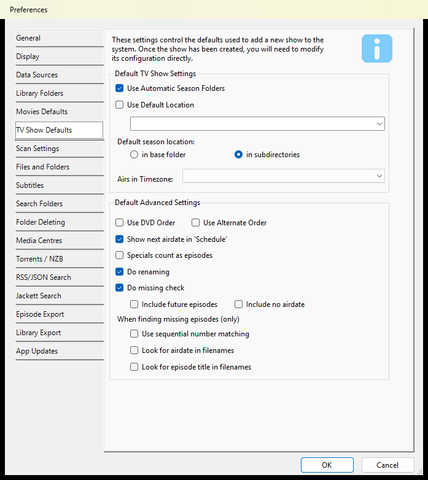

These settings are the starting values for each TV show you add to TV Rename. Changing them doesn’t change shows that are already in TV Rename: edit those with `Edit` on the [TV Shows](../main/my-tv-shows.md) tab, or use [Options>Settings Check](options-menu/settings-check.md) to find shows that differ from these defaults.

**Default TV Show Settings**

* **Use Automatic Season Folders** – new shows have **Automatic Folders** ticked on the [Folders tab](../main/my-tv-shows.md#the-folders-tab) of Add/Edit Show.
* **Use Default Location** – new shows go in the TV library folder chosen in the box under it, in a folder named with the **Show folder format** from the [Library Folders](preferences.md#the-library-folders-tab) tab. The box lists your **TV Library Folders**. This needs **Use Automatic Season Folders** ticked as well.
* **Default season location** – **in base folder** keeps all of a new show’s seasons in the show’s own folder; **in subdirectories** gives each season a folder of its own.
* **Airs in Timezone** – the time zone new shows air in. TV Rename uses it to show air times in your own time zone.

**Default Advanced Settings** are the starting ticks for a new show’s [Advanced tab](../main/my-tv-shows.md#the-advanced-tab) of Add/Edit Show, where most of them are explained. **Use DVD Order** and **Use Alternate Order** can’t both be ticked. Under **When finding missing episodes (only)**:

* **Use sequential number matching** – match a file to an episode by the episode’s overall number in the show.
* **Look for airdate in filenames** – match a file to an episode by an air date in the file name.
* **Look for episode title in filenames** – match a file to an episode by the episode’s title in the file name.

These settings are the starting values for each TV show you add to TV Rename. Changing them doesn’t change shows that are already in TV Rename: edit those with `Edit` on the [TV Shows](../main/my-tv-shows.md) tab, or use [Options>Settings Check](options-menu/settings-check.md) to find shows that differ from these defaults.

**Default TV Show Settings**

* **Use Automatic Season Folders** – new shows have **Automatic Folders** ticked on the [Folders tab](../main/my-tv-shows.md#the-folders-tab) of Add/Edit Show.
* **Use Default Location** – new shows go in the TV library folder chosen in the box under it, in a folder named with the **Show folder format** from the [Library Folders](preferences.md#the-library-folders-tab) tab. The box lists your **TV Library Folders**. This needs **Use Automatic Season Folders** ticked as well.
* **Default season location** – **in base folder** keeps all of a new show’s seasons in the show’s own folder; **in subdirectories** gives each season a folder of its own.
* **Airs in Timezone** – the time zone new shows air in. TV Rename uses it to show air times in your own time zone.

**Default Advanced Settings** are the starting ticks for a new show’s [Advanced tab](../main/my-tv-shows.md#the-advanced-tab) of Add/Edit Show, where most of them are explained. **Use DVD Order** and **Use Alternate Order** can’t both be ticked. Under **When finding missing episodes (only)**:

* **Use sequential number matching** – match a file to an episode by the episode’s overall number in the show.
* **Look for airdate in filenames** – match a file to an episode by an air date in the file name.
* **Look for episode title in filenames** – match a file to an episode by the episode’s title in the file name.

### Scan Settings <a href="#scan-settings" id="scan-settings"></a>

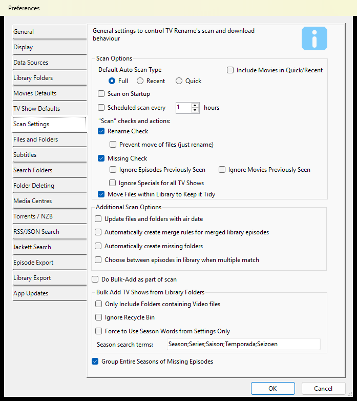

**Scan Options**

**Default Auto Scan Type** is the kind of scan TV Rename runs by itself (on startup or on a schedule):

<table data-header-hidden><thead><tr><th width="112"></th><th></th></tr></thead><tbody><tr><td><strong>Full</strong></td><td>Checks all your TV shows and movies.</td></tr><tr><td><strong>Recent</strong></td><td>Checks the TV shows that have aired recently (as set in <em>days counts as recent</em> on the <a href="preferences.md#the-general-tab">General</a> tab).</td></tr><tr><td><strong>Quick</strong></td><td>Checks the TV shows and movies that have a matching file in your <a href="preferences.md#the-search-folders-tab">Search Folders</a>, and the shows with recently missing episodes.</td></tr></tbody></table>

* **Include Movies in Quick/Recent** – a Recent scan checks your movies as well. (A Full scan always includes them.)
* **Scan on Startup** – when TV Rename starts, it runs a scan and carries out the actions it finds.
* **Scheduled scan every** … **hours** – runs a scan, and carries out the actions it finds, every so many hours.

**“Scan” checks and actions**

* **Rename Check** – renames episode and movie files in your library to match your naming settings.
  * **Prevent move of files (just rename)** – renames files where they are, without moving them to another folder.
* **Missing Check** – reports episodes and movies that aren’t in your library. This must be ticked for the checks on the [Torrents / NZB](preferences.md#torrents-nzb), [RSS / JSON Search](preferences.md#rss-json-search) and [Jackett Search](preferences.md#jackett-search) tabs to run.
  * **Ignore Episodes Previously Seen** and **Ignore Movies Previously Seen** – don’t report an episode or movie as missing if TV Rename has already put a file for it in your library before (for example, if you deleted it after watching it).
  * **Ignore Specials for all TV Shows** – don’t report specials (season 0) as missing for any show.
* **Move Files within Library to Keep it Tidy** – if files have been added to, or misplaced in, your library, TV Rename moves them to the right folders with the right names.

**Additional Scan Options**

*   **Update files and folders with air date** – sets the date of files and folders in your library to the episode’s original air date.

    **NOTE:** a NAS that runs Linux can’t store dates before 01/01/1970 00:00, so episodes that first aired earlier get that date instead.
*   **Automatically create merge rules for merged library episodes** – if a file name is a multi-episode name (see [Options>Filename Processors](options-menu/filename-processors.md)), TV Rename creates the matching merge rule. For example, if your library contains:

    ```
      ├─ My Favourite Show
      │   ├─ Season 1
      │   │  ├─ My Favourite Show - S01E01 - A Great Episode
      │   │  ├─ My Favourite Show - S01E02E03 - A Great Double Episode
      │   │  ├─ My Favourite Show - S01E05 - Another Great Episode
      │   │  ├─...
    ```

    Un-ticked, E03 and E04 are reported as missing (and S01E02E03 is renamed to S01E02). Ticked, a merge rule for S01E02E03 is created and only S01E04 is reported as missing.
* **Automatically create missing folders** – TV Rename creates missing folders in your library without asking.
* **Choose between episodes in library when multiple match** – when a file should be renamed but a file with that name is already there, TV Rename asks you which one to keep. (It doesn’t ask during unattended runs.)

**Do Bulk-Add as part of scan** – runs [Tools>Bulk Add TV Shows](tools-menu/bulk-add.md) as part of each scan.

**Bulk Add TV Shows from Library Folders** – these settings are used by Bulk Add, whether you run it from the Tools menu or as part of a scan:

* **Only Include Folders containing Video files** – only folders with video files in them are considered.
* **Ignore Recycle Bin** – the Windows Recycle Bin is skipped, even if it holds video files.
* **Force to Use Season Words from Settings Only** – Bulk Add uses only the **Season search terms** below to recognise season folders. Un-ticked (recommended), it also uses the season words from each show’s own settings.
* **Season search terms** – words in a folder name that show the folder holds one season of a show, separated by semicolons.

**Group Entire Seasons of Missing Episodes** – when every episode of a season is missing, the Scan tab lists the whole season as one item.

_Defaults: **Full**; **Rename Check**, **Missing Check** and **Move Files within Library to Keep it Tidy** ticked; scheduled scan every **1** hour (un-ticked); Season search terms **Season;Series;Saison;Temporada;Seizoen**; **Group Entire Seasons of Missing Episodes** ticked; everything else un-ticked._

### Files and Folders <a href="#the-files-and-folders-tab" id="the-files-and-folders-tab"></a>

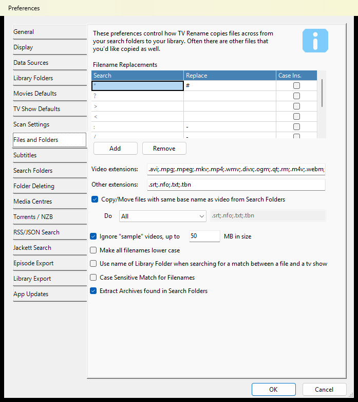

These settings control how TV Rename copies or moves files from your [Search Folders](preferences.md#the-search-folders-tab) to your [Library Folders](preferences.md#the-library-folders-tab).

**Filename Replacements** – some characters can’t be used in Windows file names. When a name contains one, TV Rename checks this list, row by row, for what to use instead. Use `Add` and `Remove` to change the list, and tick **Case Ins.** to make a row ignore upper and lower case.

**Video extensions** – the file extensions TV Rename treats as videos, separated by semicolons, with no spaces, each starting with a “.”.

_Default:_ **.avi;.mpg;.mpeg;.mkv;.mp4;.wmv;.divx;.ogm;.qt;.rm;.m4v;.webm;.vob;.ovg;.ogg;.mov;.m4p;.3gp;.wtv;.ts**

**Other extensions** – files in your library with these extensions are renamed along with their video. They follow the same rules as **Video extensions**.

| _Defaults:_ |                                                                                                                                                                                                                                |
| ----------- | ------------------------------------------------------------------------------------------------------------------------------------------------------------------------------------------------------------------------------ |
| _**.srt**_  | Subtitles in text format.                                                                                                                                                                                                      |
| _**.nfo**_  | An XML style file that contains information about the video, such as a title, summary, list of actors, year of production etc. This information is often used by media players to provide a more immersive viewing experience. |
| _**.txt**_  | Text files can be any text but quite often, if the base name of the text file is the same as that of the video file, they contain subtitles in text format.                                                                    |
| _**.tbn**_  | A KODI/XBMC specific jpeg.                                                                                                                                                                                                     |

**Copy/Move files with same base name as video from Search Folders** – files that belong to a video usually share its name, for example BigBuckBunny.avi, BigBuckBunny.sub and BigBuckBunny.nfo. When ticked, TV Rename copies or moves these files with the video. The **Do** drop-down and the box next to it choose which ones:

* **All** – all of them (the box is ignored).
* **All but these** – all except the extensions in the box.
* **Just** – only the extensions in the box.

This list can be different from **Other extensions**. For example, you may not want .nfo files copied from your Search Folders because TV Rename creates its own, but you still want them renamed in your library.

* **Ignore “sample” videos, up to** … **MB in size** – video files with “sample” in their name that are no bigger than this are ignored.
* **Make all filenames lower case** – file names TV Rename creates are all lower case.
* **Use name of Library Folder when searching for a match between a file and a tv show** – TV Rename also looks at the name of the library folder a file is in, so the show’s name doesn’t have to be in the file name.
* **Case Sensitive Match for Filenames** – a movie file whose name differs from the expected name only in upper and lower case is renamed to match exactly.
* **Extract Archives found in Search Folders** – archive files (such as .rar or .7z files) in your Search Folders are extracted during a scan.

_Defaults: **Copy/Move files with same base name** ticked, **Do All**, list **.srt;.nfo;.txt;.tbn**; **Ignore “sample” videos** ticked, up to **50** MB; **Extract Archives found in Search Folders** ticked; everything else un-ticked._

### Subtitles <a href="#subtitles" id="subtitles"></a>

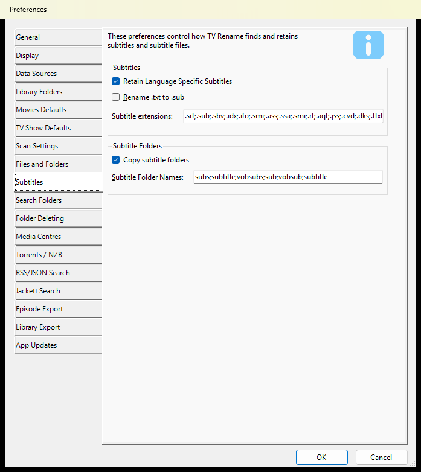

These settings control how TV Rename handles subtitle files.

* **Retain Language Specific Subtitles** – keeps the two- or three-letter language code in a subtitle file’s name, for example “Video S01E01.en.srt”. The name must be in the form _name.language.extension_.
* **Rename .txt to .sub** – subtitle files often come with a .txt extension, for example BigBuckBunny.txt. When ticked, TV Rename renames them to .sub when it copies or moves them.
* **Subtitle extensions** – the file extensions TV Rename treats as subtitles.

**Subtitle Folders**

* **Copy subtitle folders** – when TV Rename copies or moves a video from a Search Folder, it also copies a subtitle folder found next to it.
* **Subtitle Folder Names** – the folder names that count as subtitle folders.

_Defaults: **Retain Language Specific Subtitles** ticked, **Rename .txt to .sub** un-ticked, Subtitle extensions **.srt;.sub;.sbv;.idx;.ifo;.smi;.ass;.ssa;.smi;.rt;.aqt;.jss;.cvd;.dks;.ttxt;.mpl;.pjs;.psb;.ssf;.svcd;.usf**, **Copy subtitle folders** ticked, Subtitle Folder Names **subs;subtitle;vobsubs;sub;vobsub;subtitle**._

### Search Folders <a href="#the-search-folders-tab" id="the-search-folders-tab"></a>

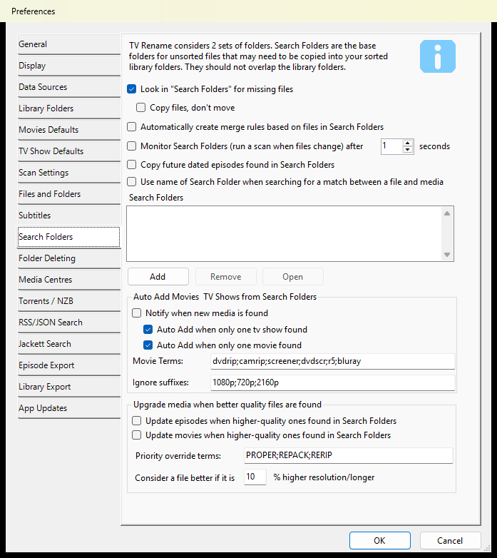

Search Folders tell TV Rename where to look for new, unsorted files **before** they are processed and copied or moved into your library. Good choices are your downloads folder, or the folder you rip DVDs or Blu-rays to. Search Folders shouldn’t overlap your Library Folders.

Use `Add` to browse to a folder and add it, `Remove` to remove the selected folder, and `Open` to see what is in it.

* **Look in “Search Folders” for missing files** – scans look in your Search Folders for missing episodes and movies.
  * **Copy files, don’t move** – files are copied into your library, leaving the originals where they are.
* **Automatically create merge rules based on files in Search Folders** – like the merge rule setting on the [Scan Settings](preferences.md#scan-settings) tab, but the rule is created before the file is copied or moved.
* **Monitor Search Folders (run a scan when files change) after** … **seconds** – when the contents of a Search Folder change, TV Rename waits this many seconds, then runs a scan and carries out the actions it finds.
* **Copy future dated episodes found in Search Folders** – episodes are copied into your library even if they haven’t officially aired yet.
* **Use name of Search Folder when searching for a match between a file and media** – TV Rename also looks at the name of the folder a file is in, so the show or movie name doesn’t have to be in the file name.

**Auto Add Movies & TV Shows from Search Folders**

* **Notify when new media is found** – during a scan, TV Rename offers to add shows and movies found in your Search Folders that aren’t in TV Rename yet.
  * **Auto Add when only one tv show found** and **Auto Add when only one movie found** – when the search for a name finds just one match, it is added without asking.
* **Movie Terms** – if a file name contains any of these words, the file is treated as a movie, not a TV show.
* **Ignore suffixes** – these words, and anything after them in a file name, are ignored when TV Rename searches for the show’s name.

**Upgrade media when better quality files are found**

* **Update episodes when higher-quality ones found in Search Folders** and **Update movies when higher-quality ones found in Search Folders** – replace files in your library with better versions found in your Search Folders.
* **Priority override terms** – words in a file name that mark it as an improved release, separated by semicolons.
* **Consider a file better if it is** … **% higher resolution/longer** – how much higher the resolution, or how much longer, a new file must be to replace the one in your library.

_Defaults: **Look in “Search Folders” for missing files** ticked; Monitor after **1** second (un-ticked); **Auto Add when only one tv show found** and **Auto Add when only one movie found** ticked; Movie Terms **dvdrip;camrip;screener;dvdscr;r5;bluray**; Ignore suffixes **1080p;720p;2160p**; Priority override terms **PROPER;REPACK;RERIP**; **10%**; everything else un-ticked._

### Folder Deleting <a href="#the-folder-deleting-tab" id="the-folder-deleting-tab"></a>

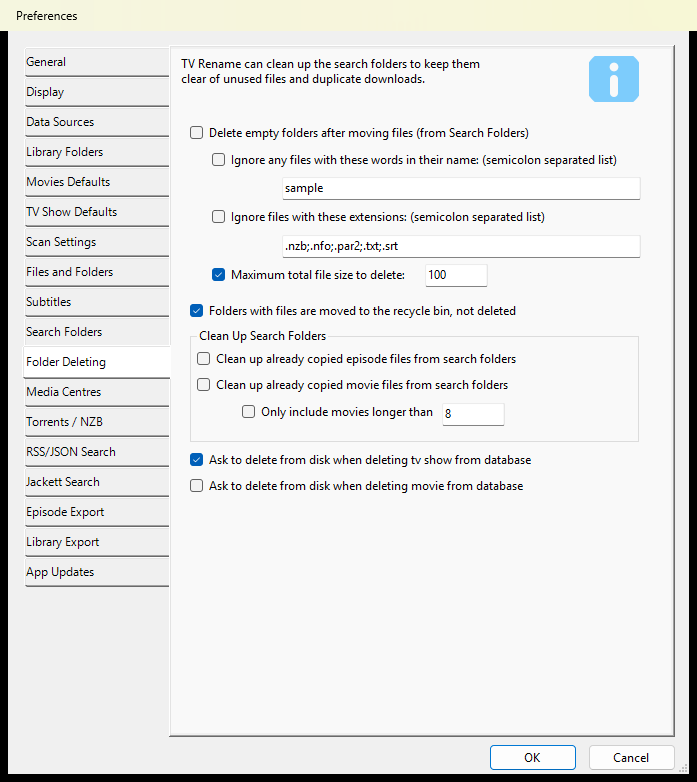

This tab is about TV Rename tidying up after itself. Downloads often come with .nfo files, pictures, sample videos and other files. TV Rename takes care of the video and the files your media player needs; these settings take care of the rest.

* **Delete empty folders after moving files (from Search Folders)** – after moving files out of a Search Folder, TV Rename deletes the folder they were in if nothing is left in it. The three settings under it let it delete folders that still hold leftovers:
  * **Ignore any files with these words in their name** – files with these words in their name don’t count. This applies to folders too.
  * **Ignore files with these extensions** – files with these extensions don’t count.
  * **Maximum total file size to delete** – the most that a folder’s remaining files can add up to (in MB) for the folder to be deleted.
* **Folders with files are moved to the recycle bin, not deleted** – folders that still hold files go to the Recycle Bin, so you can get them back.

**Clean Up Search Folders**

* **Clean up already copied episode files from search folders** and **Clean up already copied movie files from search folders** – if you copy (rather than move) files into your library, these delete video files left in your Search Folders that TV Rename no longer needs.
  * **Only include movies longer than** … – only clean up a movie file when the movie’s name is longer than this many letters, so a short name like “Up” doesn’t match the wrong files.
* **Ask to delete from disk when deleting tv show from database** and **Ask to delete from disk when deleting movie from database** – when you delete a show or movie from TV Rename, it asks whether to delete its files too.

_Defaults: ignore words **sample**, ignore extensions **.nzb;.nfo;.par2;.txt;.srt**, **Maximum total file size to delete** ticked at **100**, **Folders with files are moved to the recycle bin** ticked, movie name length **8**, **Ask to delete from disk when deleting tv show** ticked, everything else un-ticked._

### Media Centres <a href="#the-media-centers-tab" id="the-media-centers-tab"></a>

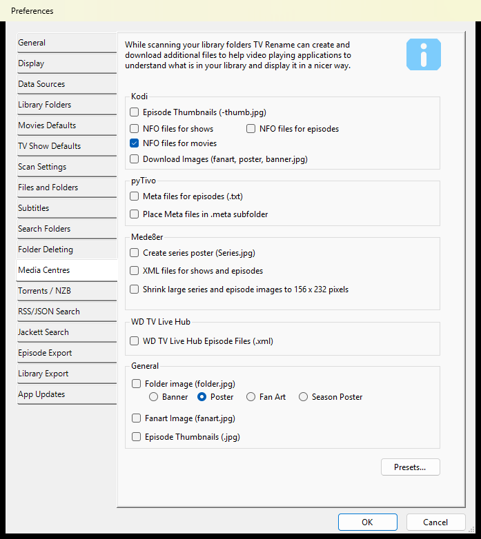

While it scans your library, TV Rename can create and download extra files that help media players show your library nicely. Tick the files your media player uses:

* **Kodi** – Episode Thumbnails (-thumb.jpg), NFO files for shows, NFO files for episodes, NFO files for movies, and Download Images (fanart, poster, banner.jpg).
* **pyTivo** – Meta files for episodes (.txt), optionally placed in a .meta subfolder.
* **Mede8er** – Create series poster (Series.jpg), XML files for shows and episodes, and Shrink large series and episode images to 156 x 232 pixels.
* **WD TV Live Hub** – WD TV Live Hub Episode Files (.xml).
* **General** – Folder image (folder.jpg), using the show’s **Banner**, **Poster**, **Fan Art** or **Season Poster**; Fanart Image (fanart.jpg); and Episode Thumbnails (.jpg).

The `Presets...` button sets the ticks on this tab for **Kodi**, **pyTivo** or **Mede8er** in one go, or **None**.

_Defaults: **NFO files for movies** ticked, Folder image picture **Poster**, everything else un-ticked._

### Torrents / NZB <a href="#torrents-nzb" id="torrents-nzb"></a>

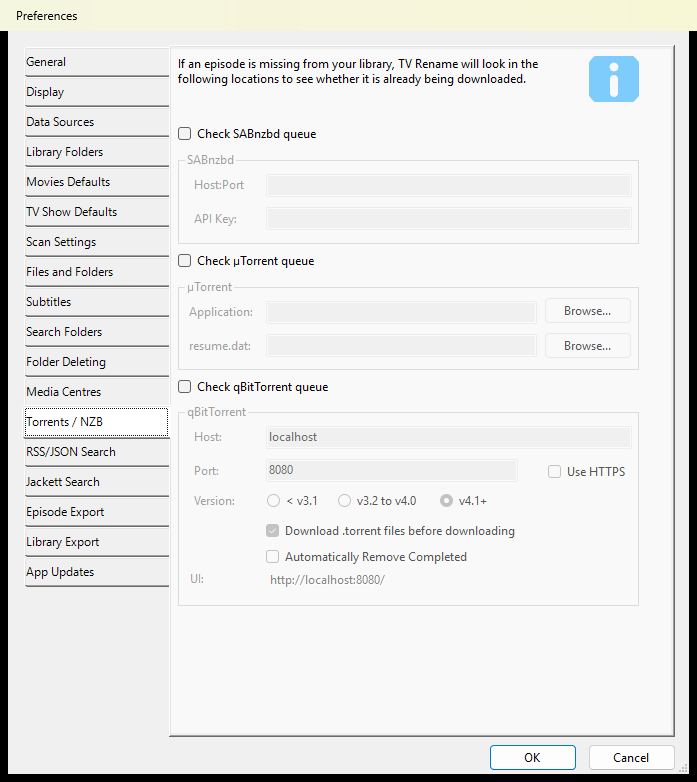

If an episode is missing from your library, TV Rename can check whether it is already being downloaded by SABnzbd, µTorrent or qBittorrent. These checks need **Missing Check** ticked on the [Scan Settings](preferences.md#scan-settings) tab.

* **Check SABnzbd queue** – needs SABnzbd’s **Host:Port** and **API Key**.
* **Check µTorrent queue** – needs the paths of µTorrent’s **Application** and its **resume.dat** file (use the `Browse...` buttons to find them).
* **Check qBitTorrent queue** – TV Rename talks to qBittorrent through its Web UI, so turn on the Web UI in qBittorrent and tell it to “Bypass authentication for clients on localhost”. Then set:
  * **Host** and **Port** of the Web UI, and **Use HTTPS** if it uses HTTPS. The **UI** line shows the resulting address.
  * **Version** – the version of qBittorrent you have: **< v3.1**, **v3.2 to v4.0** or **v4.1+**.
  * **Download .torrent files before downloading** – TV Rename downloads the .torrent file itself and gives the file to qBittorrent.
  * **Automatically Remove Completed** – TV Rename removes completed TV torrents from qBittorrent.

_Defaults: all three checks un-ticked; qBittorrent Host **localhost**, Port **8080**, Version **v4.1+**, **Download .torrent files before downloading** ticked._

### RSS / JSON Search <a href="#rss-json-search" id="rss-json-search"></a>

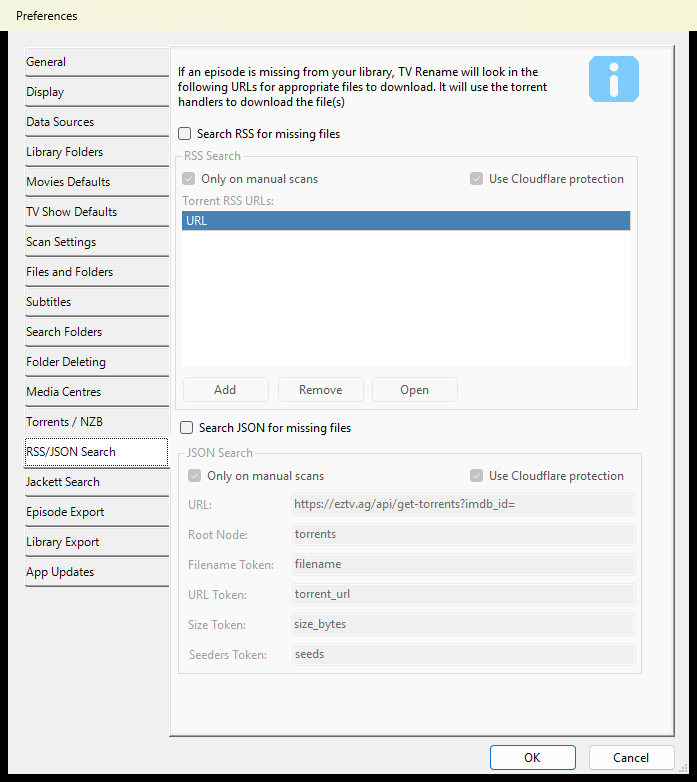

RSS and JSON searches give TV Rename more ways to find missing episodes and movies. They find download links, which TV Rename hands to your torrent program. Results are filtered by the **Preferred Terms**, **Unwanted Terms** and **Min Seeders** settings on the [Jackett Search](preferences.md#jackett-search) tab.

**Search RSS for missing files** turns on the RSS search:

* **Only on manual scans** – the RSS search runs when you start a scan yourself, not on automatic scans.
* **Use Cloudflare protection** – use this for feeds on sites protected by Cloudflare.
* **Torrent RSS URLs** – the RSS feeds to search, from indexers or public RSS sites. `Add` and `Remove` add and remove feeds, and `Open` opens the selected feed in your web browser.

**Search JSON for missing files** turns on the JSON search. It works in a similar way: it downloads information from a web address and looks for useful links. It has the same **Only on manual scans** and **Use Cloudflare protection** settings.

**NOTE:** the JSON search is set up for the EZTV site, which may not work in some countries because of internet provider filtering.

The JSON search:

1. Takes the **URL** from the settings.
2. Adds the show’s IMDB id to the end.
3. Downloads the data.
4. Goes to the part of the data named in **Root Node**.
5. Looks through the items there for the **Filename Token** and **URL Token** (and the **Size Token** and **Seeders Token**).
6. If the file name looks like the missing episode, downloads the link.

_Defaults: both searches un-ticked; **Only on manual scans** and **Use Cloudflare protection** ticked for both; URL **https://eztv.ag/api/get-torrents?imdb\_id=**, Root Node **torrents**, Filename Token **filename**, URL Token **torrent\_url**, Size Token **size\_bytes**, Seeders Token **seeds**._

### Jackett Search <a href="#jackett-search" id="jackett-search"></a>

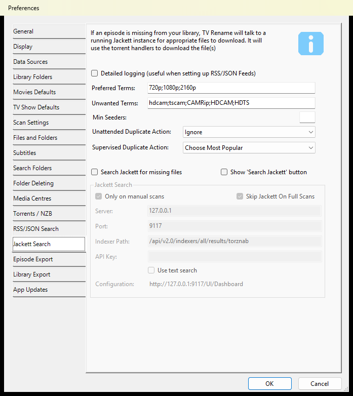


Jackett is an external program and is not supported by the TV Rename team. It is available from [here](https://github.com/Jackett/Jackett#installation-on-windows)


If an episode or movie is missing from your library, TV Rename can ask a running Jackett server for files to download, and hand them to your torrent program.

The settings at the top of the tab apply to the RSS and JSON searches as well as to Jackett:

* **Detailed logging (useful when setting up RSS/JSON Feeds)** – writes much more detail about the JSON and Jackett searches to the [log](../help-and-support/keyboard-shortcuts.md). Only use it while you need it, as the log file grows very quickly.
* **Preferred Terms** – results with more of these words in their name are preferred, separated by semicolons.
* **Unwanted Terms** – results with any of these words in their name are skipped.
* **Min Seeders** – results with fewer seeders than this are skipped. Leave it empty for no minimum.
* **Unattended Duplicate Action** and **Supervised Duplicate Action** – what to do when more than one result is found for the same episode, during unattended runs and when you are there: **Ask User**, **Choose Largest File**, **Choose Most Popular**, **Download All**, **Ignore** or **Use First**.

**Search Jackett for missing files** turns on the Jackett search:

* **Server**, **Port**, **Indexer Path** and **API Key** – where to find your Jackett server. The **Configuration** line shows the address of Jackett’s own settings page.
* **Only on manual scans** – the Jackett search runs when you start a scan yourself, not on automatic scans.
* **Skip Jackett On Full Scans** – the Jackett search doesn’t run during Full scans.
* **Use text search** – searches Jackett by name only.

**Show ‘Search Jackett’ button** – adds a **Jackett Search** button to the Scan and Schedule tabs.

_Defaults: Preferred Terms **720p;1080p;2160p**, Unwanted Terms **hdcam;tscam;CAMRip;HDCAM;HDTS**, Min Seeders empty, Unattended **Ignore**, Supervised **Choose Most Popular**; Server **127.0.0.1**, Port **9117**, Indexer Path **/api/v2.0/indexers/all/results/torznab**; **Only on manual scans** and **Skip Jackett On Full Scans** ticked; everything else un-ticked._

### Episode Export <a href="#episode-export" id="episode-export"></a>

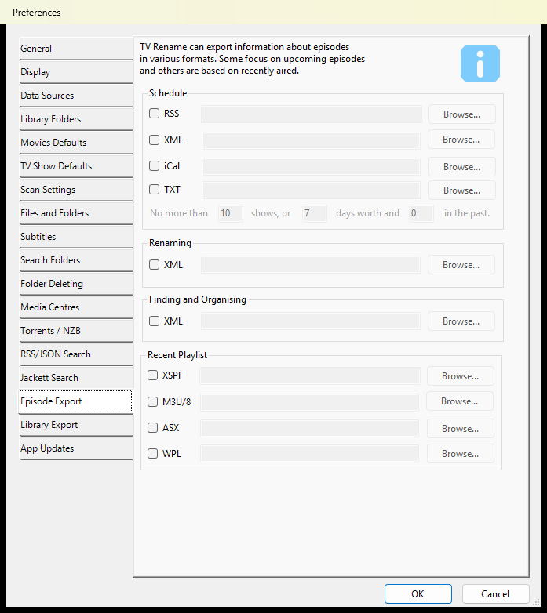

TV Rename can save information about episodes to files, for other programs to use. Tick a box, then type a file location or use `Browse...` to choose one.

**Schedule** – upcoming episodes from the [Schedule](../main/when-to-watch.md) tab:

* **RSS** – a file that RSS readers can show.
* **XML** – a standard XML file.
* **iCal** – an Internet Calendar (.ics) file that calendar programs can open.
* **TXT** – a plain text file.

**No more than** … **shows, or** … **days worth and** … **in the past** limits how much is written to these files. They are updated whenever the Schedule tab is refreshed.

**Renaming** – **XML** saves the renames found by a scan.

**Finding and Organising** – **XML** saves the files found by a scan.

**Recent Playlist** – saves a playlist of the episodes in the “Aired in the last N days” section of the Schedule tab, in **XSPF**, **M3U/8**, **ASX** or **WPL** format.

_Defaults: all un-ticked; no more than **10** shows, or **7** days worth and **0** in the past._

### Library Export <a href="#library-export" id="library-export"></a>

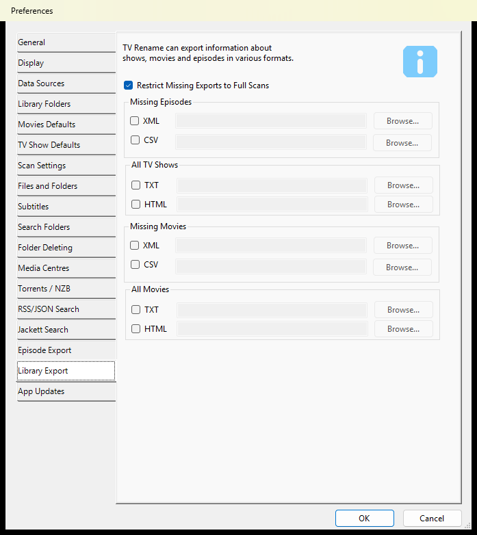

TV Rename can also save information about your shows, movies and missing episodes. As on the Episode Export tab, tick a box and choose a file location.

* **Restrict Missing Exports to Full Scans** – the Missing Episodes and Missing Movies files are only saved after a Full scan.
* **Missing Episodes** and **Missing Movies** – save what a scan finds missing, as an **XML** or **CSV** file.
* **All TV Shows** and **All Movies** – save a list of everything in TV Rename, as a **TXT** file, or as an **HTML** page with a summary of each show or movie, complete with pictures and other details.

You can save all your export files at any time with **File>Export**, or only the shows and movies shown by your current filters with **File>Export Filtered**.

_Defaults: **Restrict Missing Exports to Full Scans** ticked, all exports un-ticked._

### App Updates <a href="#app-updates" id="app-updates"></a>

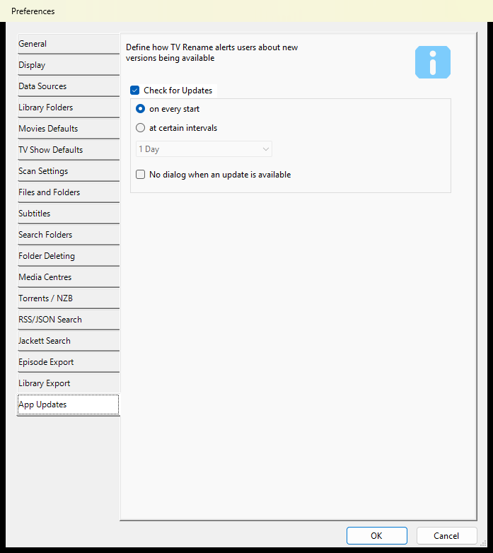

These settings control how TV Rename tells you about new versions.

* **Check for Updates** – untick this to stop TV Rename checking for new versions by itself.
* **on every start** – TV Rename checks each time it starts.
* **at certain intervals** – TV Rename checks when it starts, but only if the time chosen in the box (from 1 Hour to 90 Days) has passed since its last check.
* **No dialog when an update is available** – when an automatic check finds a new version, TV Rename doesn’t open a window about it. An `Update Available...` button shows in the main window instead.

You can check for a new version yourself at any time with **Help>Check For New Version**.

_Defaults: **Check for Updates** ticked, **on every start**, **No dialog when an update is available** un-ticked._

These settings control how TV Rename tells you about new versions.

* **Check for Updates** – untick this to stop TV Rename checking for new versions by itself.
* **on every start** – TV Rename checks each time it starts.
* **at certain intervals** – TV Rename checks when it starts, but only if the time chosen in the box (from 1 Hour to 90 Days) has passed since its last check.
* **No dialog when an update is available** – when an automatic check finds a new version, TV Rename doesn’t open a window about it. An `Update Available...` button shows in the main window instead.

You can check for a new version yourself at any time with **Help>Check For New Version**.

_Defaults: **Check for Updates** ticked, **on every start**, **No dialog when an update is available** un-ticked._
