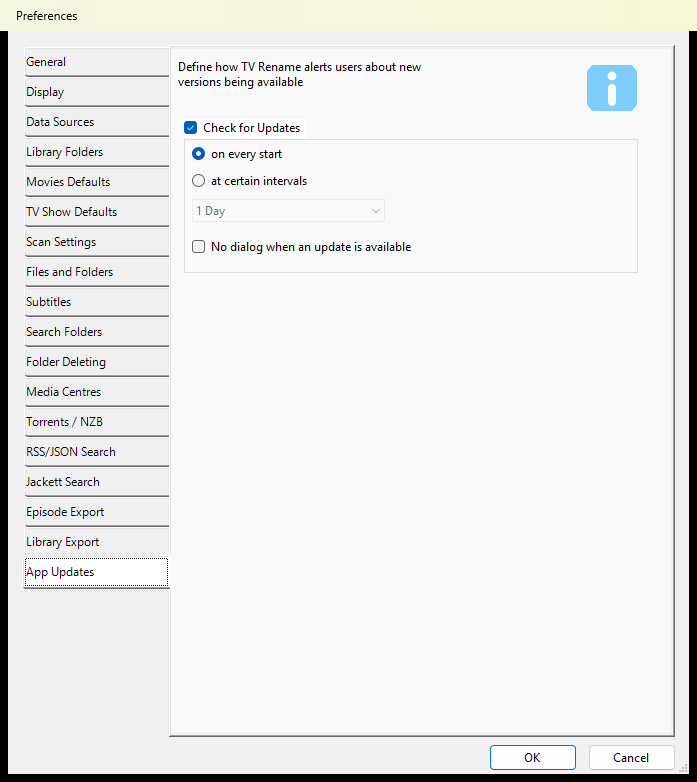

# App Updates

These settings control update notifications.

* **Check for Updates** – disable automatic update checks.
* **on every start** – check at every startup.
* **at certain intervals** – check at startup only after the selected interval.
* **No dialog when an update is available** – show an `Update Available...` button instead of a dialog.

Use **Help>Check For New Version** to check manually.

_Defaults: Check for Updates ticked, on every start, No dialog when an update is available un-ticked._
