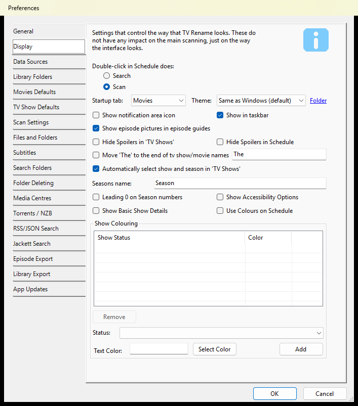

# Display

The Display tab changes how TV Rename looks. It doesn’t change what scans do.

* **Double-click in Schedule does** – choose **Search** or **Scan**.
* **Startup tab** – choose **Movies**, **TV Shows**, **Scan** or **Schedule**.
* **Theme** – the colours TV Rename uses: **Same as Windows (default)**, **Light**, **Dark**, **Creme**, **Midnight** or a theme you have made. The new theme is used the next time TV Rename starts. **Folder** opens the folder that holds the theme files. See [Themes](../../main/display-view.md#themes).
* **Show notification area icon** and **Show in taskbar** – choose where TV Rename’s icon appears. At least one must be ticked.
* **Show episode pictures in episode guides** – shows each episode’s picture and description on [TV Shows](../../main/my-tv-shows.md).
* **Hide Spoilers in ‘TV Shows’** and **Hide Spoilers in Schedule** – hide unaired episode summaries.
* **Move ‘The’ to the end of tv show/movie names** – sorts “The Hollow Crown” as “Hollow Crown, The”. Enter words separated by semicolons, such as **The;A;An**. This does not rename files or folders.
* **Automatically select show and season in ‘TV Shows’** – follows selections from Schedule or Scan.
* **Seasons name** and **Leading 0 on Season numbers** – control season labels on TV Shows.
* **Show Accessibility Options** – adds a **Context Menu** button to TV Shows, Movies, Scan and Schedule.
* **Show Basic Show Details** – uses the older right-panel layout.
* **Use Colours on Schedule** – colours episodes by air date.

### Show Colouring

**Show Colouring** changes a show name’s colour based on its show or season status.

1. Choose a status from **Status**.
2. Enter a colour in **Text Color**, or select one.
3. Click `Add`.

For example, use `#808080` for “Show Status: Ended”. Select a rule and click `Remove` to delete it.

_Defaults: double-click does **Scan**, Startup tab **Movies**, Theme **Same as Windows (default)**, **Show in taskbar** ticked, **Show episode pictures in episode guides** ticked, **Automatically select show and season in ‘TV Shows’** ticked, words to move **The**, Seasons name **Season**, everything else un-ticked, no colour rules._
