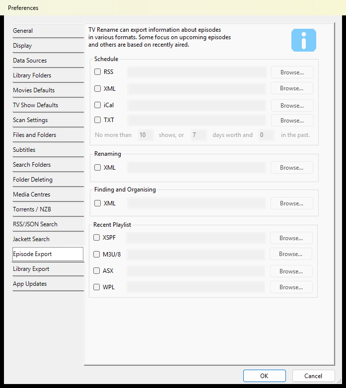

# Episode Export

TV Rename can save episode details for other programs. Enable a format and select its location.

### Schedule

Export upcoming [Schedule](../../main/when-to-watch.md) episodes as:

* **RSS**
* **XML**
* **iCal** (`.ics`)
* **TXT**

**No more than** limits exported shows, future days, and previous days. TV Rename updates these files when it refreshes Schedule.

**Renaming** exports scan renames as **XML**. **Finding and Organising** exports scan discoveries as **XML**.

**Recent Playlist** exports recent episodes in **XSPF**, **M3U/8**, **ASX**, or **WPL**.

_Defaults: all un-ticked; no more than **10** shows, **7** days worth, and **0** days in the past._
