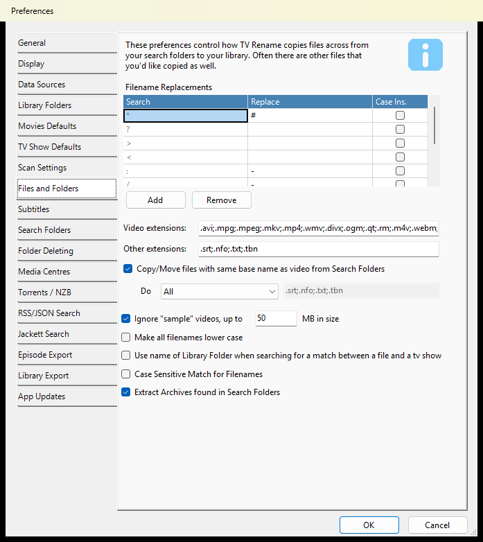

# Files and Folders

These settings control files moving from Search Folders to Library Folders.

* **Filename Replacements** – replace unsupported Windows filename characters. Use `Add` and `Remove`; **Case Ins.** ignores case.
* **Video extensions** – semicolon-separated video extensions, each starting with `.`.

_Default: **.avi;.mpg;.mpeg;.mkv;.mp4;.wmv;.divx;.ogm;.qt;.rm;.m4v;.webm;.vob;.ovg;.ogg;.mov;.m4p;.3gp;.wtv;.ts**_

**Other extensions** are renamed with their video. Defaults: **.srt;.nfo;.txt;.tbn**.

**Copy/Move files with same base name as video from Search Folders** includes related files:

* **All** – include all related files.
* **All but these** – exclude listed extensions.
* **Just** – include only listed extensions.
* **Ignore “sample” videos, up to** – ignore matching samples below the size limit.
* **Make all filenames lower case** – lowercase generated filenames.
* **Use name of Library Folder when searching for a match** – include library folder names in matching.
* **Case Sensitive Match for Filenames** – correct case-only filename differences.
* **Extract Archives found in Search Folders** – extract `.rar`, `.7z`, and similar archives.

_Defaults: Copy/Move files with same base name ticked, **Do All**, list **.srt;.nfo;.txt;.tbn**; Ignore samples ticked up to **50** MB; Extract Archives ticked; everything else un-ticked._
