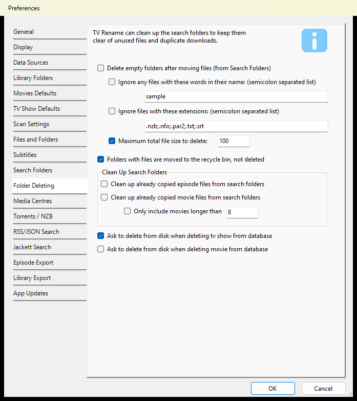

# Folder Deleting

These settings clean up downloads after TV Rename processes them.

* **Delete empty folders after moving files** – remove empty Search Folder directories.
  * **Ignore any files with these words in their name** – excluded files and folders do not prevent deletion.
  * **Ignore files with these extensions** – excluded extensions do not prevent deletion.
  * **Maximum total file size to delete** – maximum remaining size in MB.
* **Folders with files are moved to the recycle bin, not deleted** – retain recoverable folders.

### Clean Up Search Folders

* **Clean up already copied episode files** and **Clean up already copied movie files** – delete copied files left in Search Folders.
  * **Only include movies longer than** – require a minimum movie-title length.
* **Ask to delete from disk when deleting tv show from database** and **Ask to delete from disk when deleting movie from database** – prompt before deleting files.

_Defaults: ignore words **sample**, ignore extensions **.nzb;.nfo;.par2;.txt;.srt**, Maximum total file size ticked at **100** MB, folders with files sent to Recycle Bin, movie name length **8**, ask to delete TV show files ticked; everything else un-ticked._
