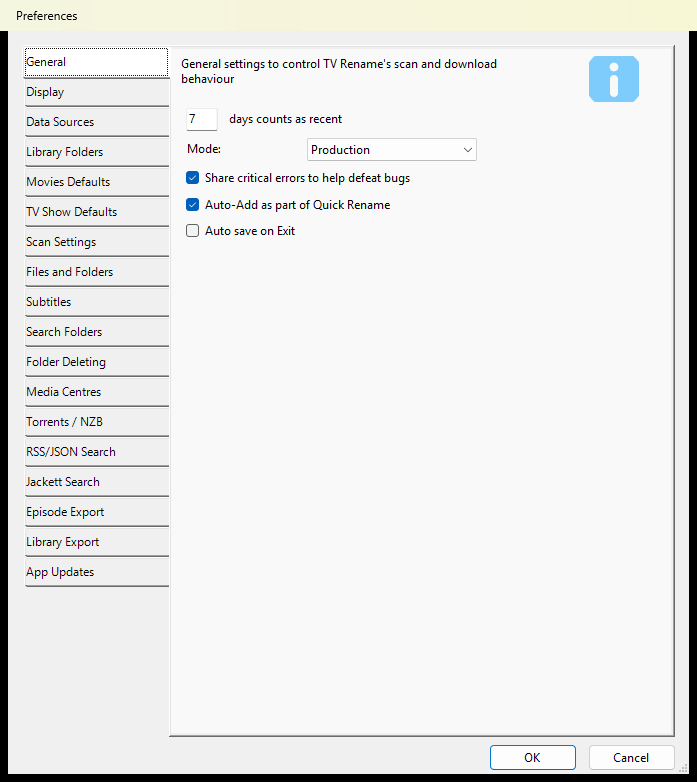

# General

* **days counts as recent** – how many days count as “recent”. It sets how many days are listed in the “Aired in the last N days” section of the [Schedule](../../main/when-to-watch.md) tab, and which shows a **Recent** scan checks.
* **Mode** – **Production** or **Beta**. In **Beta** mode a [Beta](../beta-menu.md) menu appears between **View** and **Help**, giving you a preview of features still being worked on, and TV Rename offers Beta and RC updates.
* **Share critical errors to help defeat bugs** – lets TV Rename send anonymous crash details to [SolarWinds Papertrail](https://www.papertrail.com/).

_Defaults: **7** days, **Production**, **Share critical errors** ticked, **Auto-Add as part of Quick Rename** ticked, **Auto save on Exit** un-ticked._
