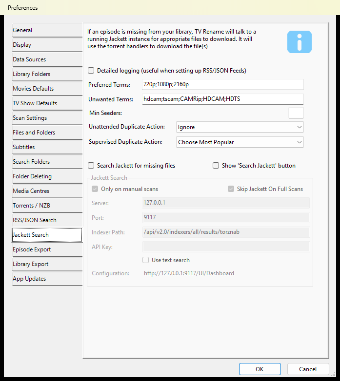

# Jackett Search


Jackett is external software. Install it from [Jackett](https://github.com/Jackett/Jackett#installation-on-windows).


TV Rename can ask a running Jackett server for missing media.

* **Detailed logging** – add detailed JSON and Jackett search logs.
* **Preferred Terms** – prefer results containing these semicolon-separated terms.
* **Unwanted Terms** – skip results containing these terms.
* **Min Seeders** – skip results with fewer seeders. Leave empty for no minimum.
* **Unattended Duplicate Action** and **Supervised Duplicate Action** – choose how duplicate results are handled.

### Jackett settings

* **Search Jackett for missing files** – enable search.
* **Server**, **Port**, **Indexer Path**, and **API Key** – Jackett connection values.
* **Only on manual scans** – skip automatic scans.
* **Skip Jackett On Full Scans** – skip Full scans.
* **Use text search** – search Jackett by name only.
* **Show ‘Search Jackett’ button** – add a Jackett Search button to Scan and Schedule.

_Defaults: Preferred Terms **720p;1080p;2160p**, Unwanted Terms **hdcam;tscam;CAMRip;HDCAM;HDTS**, Min Seeders empty, Unattended **Ignore**, Supervised **Choose Most Popular**; Server **127.0.0.1**, Port **9117**, Indexer Path **/api/v2.0/indexers/all/results/torznab**; manual scans and Skip Jackett On Full Scans ticked; everything else un-ticked._
