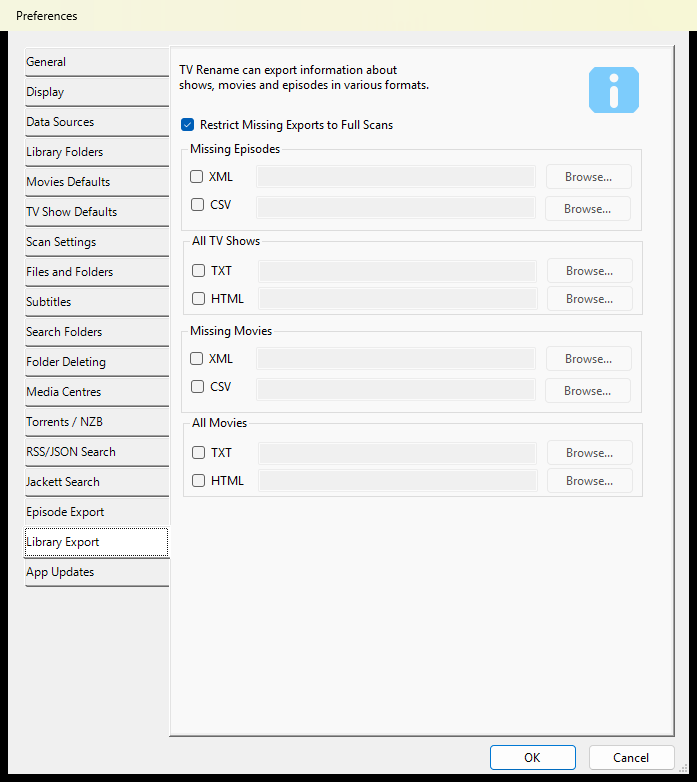

# Library Export

TV Rename can save show, movie, and missing-media information.

* **Restrict Missing Exports to Full Scans** – save missing files only after Full scans.
* **Missing Episodes** and **Missing Movies** – export missing media as **XML** or **CSV**.
* **All TV Shows** and **All Movies** – export all media as **TXT** or an illustrated **HTML** summary.

Use **File>Export** to save every export. Use **File>Export Filtered** for the current filters.

_Defaults: Restrict Missing Exports to Full Scans ticked, all exports un-ticked._
