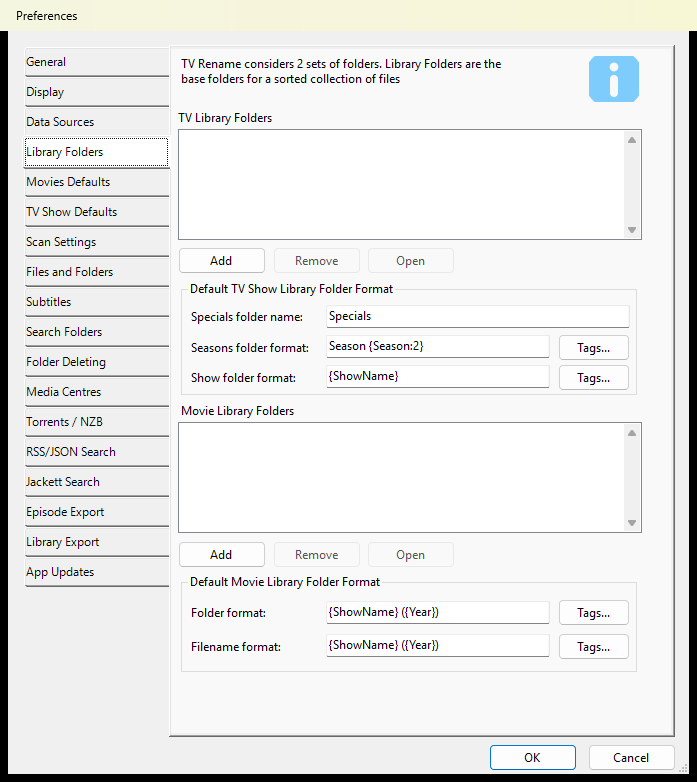

# Library Folders

Library Folders identify the sorted TV and movie collection after TV Rename processes it. Configure separate lists for TV shows and movies.

Use `Add` to select a library’s base folder. Use `Remove` to delete the selected entry. Use `Open` to view it. The base folder contains each show or movie folder, rather than an individual show folder.

### Default TV Show Library Folder Format

* **Specials folder name** – folder name for season 0.
* **Seasons folder format** – season folder pattern. Use `{Season}` or `{Season:2}`.
* **Show folder format** – folder pattern for new shows.

### Default Movie Library Folder Format

* **Folder format** – pattern for each movie folder.
* **Filename format** – pattern for each movie filename.

Use `Tags...` beside a format field to see supported tags. Common tags include `{ShowName}`, `{ShowNamePost}`, `{Year}`, `{Season}`, `{Season:2}`, `{EpisodeName}`, `{TMDBId}`, and `{ProviderId}`.

_Defaults: Specials folder name **Specials**, Seasons folder format **Season {Season:2}**, Show folder format **{ShowName}**, movie Folder format and Filename format **{ShowName} ({Year})**._
