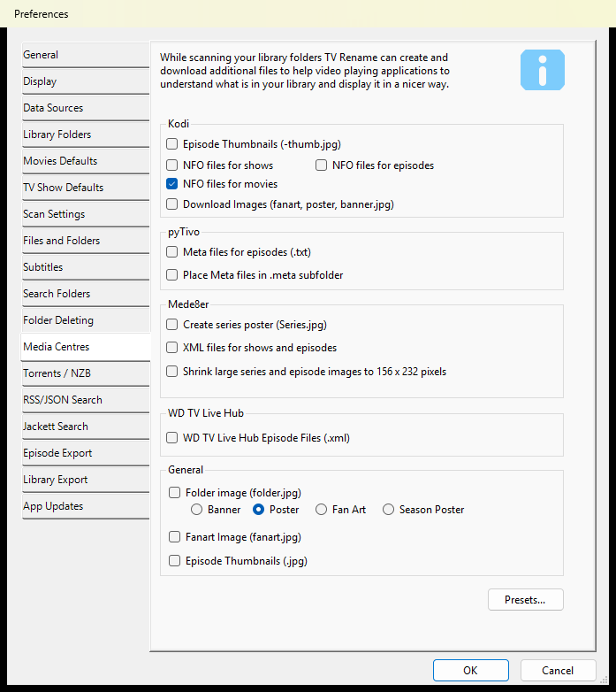

# Media Centres

TV Rename can create extra media-player files while scanning. Enable the files your player uses:

* **Kodi** – episode thumbnails, show, episode and movie NFO files, plus images.
* **pyTivo** – episode `.txt` metadata, optionally in a `.meta` folder.
* **Mede8er** – series posters, XML files, and resized series or episode images.
* **WD TV Live Hub** – episode `.xml` files.
* **General** – folder images, fanart and episode thumbnails.

`Presets...` configures **Kodi**, **pyTivo**, **Mede8er**, or **None**.

_Defaults: NFO files for movies ticked, Folder image picture **Poster**, everything else un-ticked._
