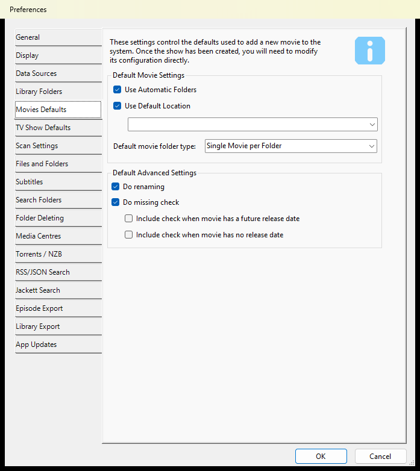

# Movies Defaults

These settings are starting values for new movies. They do not change existing movies. Edit them on [Movies](../../main/movies.md), or use [Options>Settings Check](../options-menu/settings-check.md).

### Default Movie Settings

* **Use Automatic Folders** – enables **Automatic Folders** for new movies.
* **Use Default Location** – places new movies in the selected Movie Library Folder.
* **Default movie folder type** – choose Single Movie per Folder, Many Movies per Folder, DVD format or Bluray format.

### Default Advanced Settings

* **Do renaming** – rename movie files using your naming settings.
* **Do missing check** – report missing movie files.
  * **Include check when movie has a future release date** – include unreleased movies.
  * **Include check when movie has no release date** – include movies with no release date.
