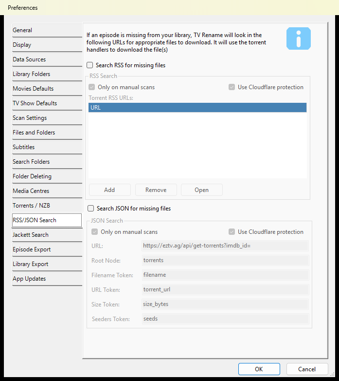

# RSS / JSON Search

RSS and JSON searches find download links for missing media. TV Rename sends those links to the torrent program. Results use Jackett Search’s preferred terms, unwanted terms, and minimum seeders.

### RSS search

**Search RSS for missing files** enables RSS search:

* **Only on manual scans** – do not run during automatic scans.
* **Use Cloudflare protection** – enable for Cloudflare-protected feeds.
* **Torrent RSS URLs** – manage feed URLs with `Add`, `Remove`, and `Open`.

### JSON search

**Search JSON for missing files** enables JSON search. It uses the same manual-scan and Cloudflare options.

The JSON search adds a show’s IMDB ID to the URL, downloads the data, opens the configured root node, and reads the filename, URL, size, and seeder tokens.

_Defaults: both searches un-ticked; manual scans and Cloudflare protection ticked; URL **https://eztv.ag/api/get-torrents?imdb\_id=**, Root Node **torrents**, Filename Token **filename**, URL Token **torrent\_url**, Size Token **size\_bytes**, Seeders Token **seeds**._
