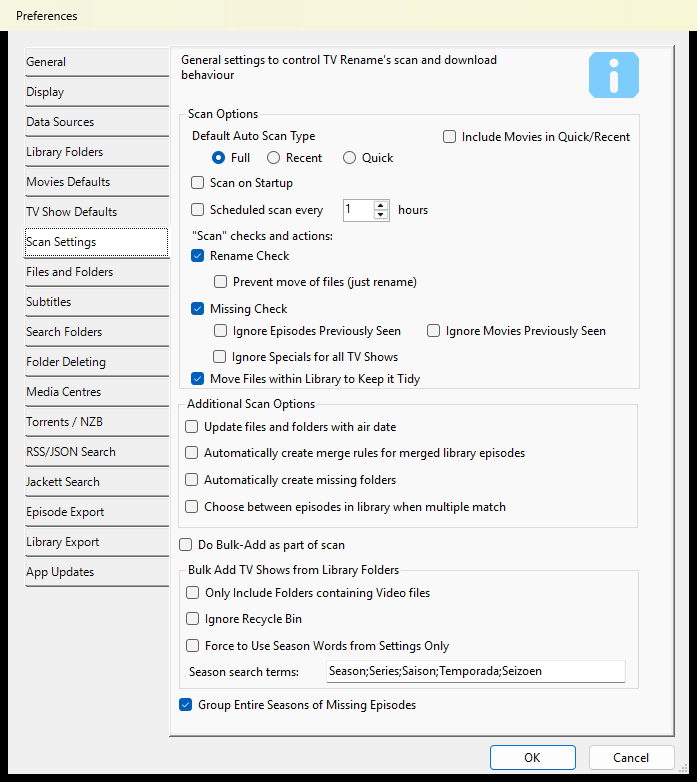

# Scan Settings

### Scan Options

**Default Auto Scan Type** chooses the automatic scan:

* **Full** – checks all TV shows and movies.
* **Recent** – checks recently aired TV shows.
* **Quick** – checks matching Search Folder files and recently missing shows.
* **Include Movies in Quick/Recent** – include movies in Recent scans.
* **Scan on Startup** – scan and carry out actions at startup.
* **Scheduled scan every** – scan and carry out actions at this interval.

### “Scan” checks and actions

* **Rename Check** – rename episode and movie files.
  * **Prevent move of files (just rename)** – rename in place.
* **Missing Check** – report missing episodes and movies. This enables torrent, RSS/JSON and Jackett checks.
  * **Ignore Episodes Previously Seen** and **Ignore Movies Previously Seen** – do not report files previously added to the library.
  * **Ignore Specials for all TV Shows** – do not report season 0 as missing.
* **Move Files within Library to Keep it Tidy** – move misplaced library files to correct folders.

### Additional Scan Options

* **Update files and folders with air date** – set dates to original air dates. Linux NAS devices use 01/01/1970 for older episodes.
* **Automatically create merge rules for merged library episodes** – create merge rules for multi-episode filenames.
* **Automatically create missing folders** – create library folders without prompting.
* **Choose between episodes in library when multiple match** – ask which file to keep, except in unattended runs.

**Do Bulk-Add as part of scan** runs [Tools>Bulk Add TV Shows](../tools-menu/bulk-add.md) during each scan.

### Bulk Add TV Shows from Library Folders

* **Only Include Folders containing Video files** – consider only folders containing videos.
* **Ignore Recycle Bin** – skip the Windows Recycle Bin.
* **Force to Use Season Words from Settings Only** – use only the terms below.
* **Season search terms** – semicolon-separated season folder words.

**Group Entire Seasons of Missing Episodes** lists fully missing seasons as one item.

_Defaults: **Full**; **Rename Check**, **Missing Check** and **Move Files within Library to Keep it Tidy** ticked; scheduled scan every **1** hour (un-ticked); Season search terms **Season;Series;Saison;Temporada;Seizoen**; **Group Entire Seasons of Missing Episodes** ticked; everything else un-ticked._
