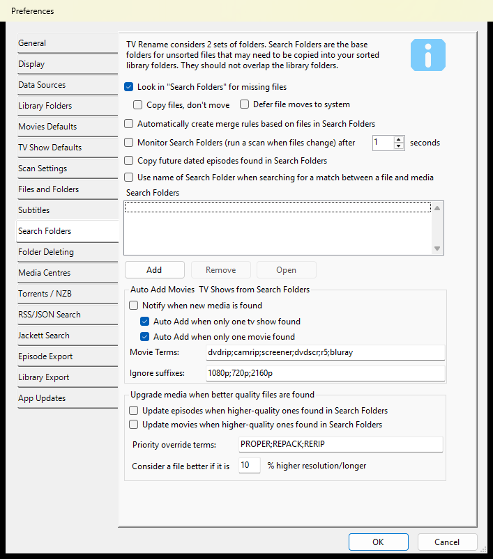

# Search Folders

Search Folders hold new, unsorted files before TV Rename moves them to Library Folders. They should not overlap Library Folders. Use `Add`, `Remove`, and `Open` to manage them.

* **Look in “Search Folders” for missing files** – include them in missing-file checks.
  * **Copy files, don’t move** – retain originals.
  * **Defer file moves to system** – ask Windows to move files across drives.
* **Automatically create merge rules based on files in Search Folders** – create rules before copying or moving.
* **Monitor Search Folders** – run a scan after changes and the chosen delay.
* **Copy future dated episodes found in Search Folders** – copy episodes before their air date.
* **Use name of Search Folder when searching for a match** – include the folder name in matching.

### Auto Add Movies & TV Shows from Search Folders

* **Notify when new media is found** – offer to add unknown shows and movies.
* **Auto Add when only one tv show found** and **Auto Add when only one movie found** – add a single match automatically.
* **Movie Terms** – terms that identify movies.

### Upgrade media when better quality files are found

* **Update episodes when higher-quality ones found** and **Update movies when higher-quality ones found** – replace library files with better versions.
* **Priority override terms** – terms indicating improved releases.
* **Consider a file better if it is** – required resolution or duration increase.

_Defaults: Look in Search Folders ticked; Monitor after **1** second (un-ticked); automatic single-match adds ticked; Movie Terms **dvdrip;camrip;screener;dvdscr;r5;bluray**; Ignore suffixes **1080p;720p;2160p**; Priority override terms **PROPER;REPACK;RERIP**; **10%**; everything else un-ticked._
