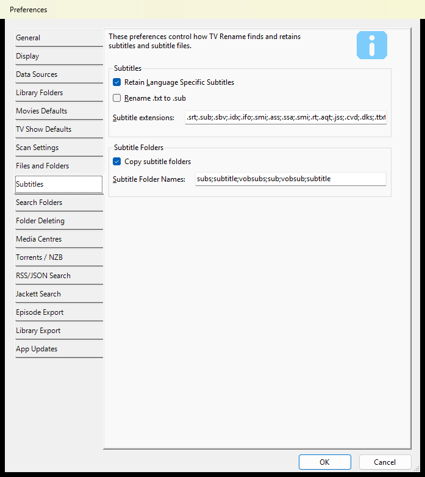

# Subtitles

These settings control subtitle files.

* **Retain Language Specific Subtitles** – retain two- or three-letter language codes, such as `Video S01E01.en.srt`.
* **Rename .txt to .sub** – rename `.txt` subtitle files while copying or moving.
* **Subtitle extensions** – extensions treated as subtitles.

### Subtitle Folders

* **Copy subtitle folders** – copy a subtitle folder beside a moved video.
* **Subtitle Folder Names** – folder names treated as subtitle folders.

_Defaults: Retain Language Specific Subtitles ticked, Rename .txt to .sub un-ticked, Subtitle extensions **.srt;.sub;.sbv;.idx;.ifo;.smi;.ass;.ssa;.smi;.rt;.aqt;.jss;.cvd;.dks;.ttxt;.mpl;.pjs;.psb;.ssf;.svcd;.usf**, Copy subtitle folders ticked, Subtitle Folder Names **subs;subtitle;vobsubs;sub;vobsub;subtitle**._
