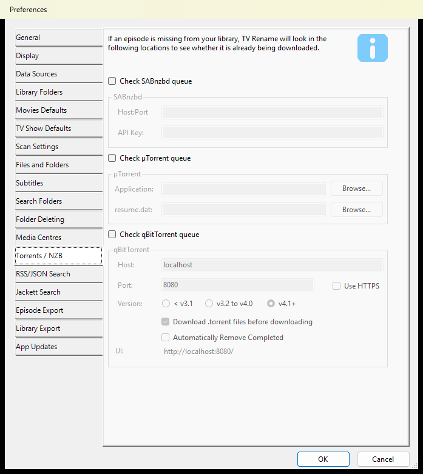

# Torrents / NZB

TV Rename can check SABnzbd, µTorrent, or qBittorrent for missing episodes. Enable **Missing Check** in Scan Settings first.

* **Check SABnzbd queue** – requires the SABnzbd **Host:Port** and **API Key**.
* **Check µTorrent queue** – requires the µTorrent application and `resume.dat` paths.
* **Check qBitTorrent queue** – uses qBittorrent’s Web UI. Enable the Web UI and bypass localhost authentication.
  * Set its **Host**, **Port**, optional **Use HTTPS**, and **Version**.
  * **Download .torrent files before downloading** – download the torrent before passing it to qBittorrent.
  * **Automatically Remove Completed** – remove completed TV torrents.

_Defaults: all checks un-ticked; qBittorrent Host **localhost**, Port **8080**, Version **v4.1+**, Download .torrent files before downloading ticked._
