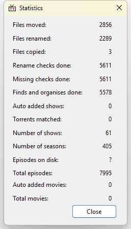

# Statistics

**View > Statistics...** shows a summary of your library and running totals of the work TV Rename has done for you.

These are running totals, kept from one session to the next:

| Item                         | What it counts                                                                                                                  |
| ---------------------------- | ------------------------------------------------------------------------------------------------------------------------------- |
| **Files moved**              | Files TV Rename has moved.                                                                                                      |
| **Files renamed**            | Files TV Rename has renamed.                                                                                                    |
| **Files copied**             | Files TV Rename has copied.                                                                                                     |
| **Rename checks done**       | Scans that included a rename check (**Rename Check** ticked in [Preferences > Scan Settings](../preferences.md#scan-settings)). |
| **Missing checks done**      | Scans that included a missing check (**Missing Check** ticked in Preferences > Scan Settings).                                  |
| **Finds and organises done** | Scans that ran to the end without being cancelled.                                                                              |
| **Auto added shows**         | TV shows added for you by Auto Add or Bulk Add TV Shows.                                                                        |
| **Torrents matched**         | Not currently counted, so it stays at 0.                                                                                        |
| **Auto added movies**        | Movies added for you by Auto Add or Bulk Add Movies.                                                                            |

These describe your library as it is now:

| Item                  | What it shows                                                 |
| --------------------- | ------------------------------------------------------------- |
| **Number of shows**   | TV shows in your library.                                     |
| **Number of seasons** | Seasons across all of those shows.                            |
| **Episodes on disk**  | Episodes found in your library folders by the last full scan. |
| **Total episodes**    | Episodes listed for all of your shows.                        |
| **Total movies**      | Movies in your library.                                       |


**Note:** "Episodes on disk:" shows a question mark until a full scan has been run since TV Rename was started, because it is only counted during a full scan.


Click `Close` to close the window.

The running totals are kept in TV Rename's Statistics.xml file, see [Logs & Configuration](../../technical/logs-and-configuration.md#configuration-files).
