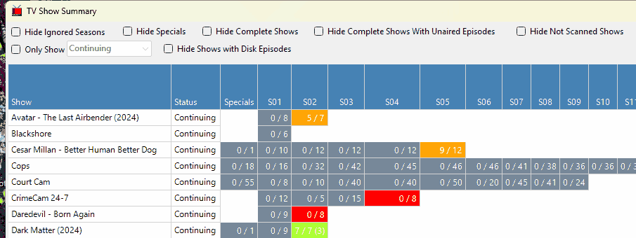

# TV Show Summary

**View > TV Show Summary...** shows every TV show in your library as a grid, one row per show and one column per season, coloured so you can see at a glance which seasons are complete and which have episodes missing.

When the window opens, TV Rename checks your library folders for every episode, with a progress bar along the bottom. This can take a little while for a large library. Click `Refresh` to check again, and `Close` when you are done. You can keep using the main window while it is open.

## Reading the grid

The columns are **Show**, **Status** (for example Continuing or Ended), **Specials**, and then **S01**, **S02** and so on for each season.

Each season shows how many of its episodes you have, out of how many have aired, for example `5 / 7`. If some episodes in the season haven't aired yet, the number still to come is added in brackets, so `7 / 7 (3)` means you have all 7 aired episodes and 3 more are still to air. The **Specials** column shows how many specials you have out of all the specials listed.

The season colouring is as follows:

| Colour           | Meaning                                                                                                                                           |
| ---------------- | ------------------------------------------------------------------------------------------------------------------------------------------------- |
| **Green**        | You have every episode in the season, and none are still to air.                                                                                  |
| **Yellow-green** | You have every episode that has aired so far, and more are still to air. This includes a season that hasn't started yet, for example `0 / 0 (4)`. |
| **Orange**       | You have some of the aired episodes, but not all of them.                                                                                         |
| **Red**          | You have none of the aired episodes.                                                                                                              |
| **Grey**         | You have told TV Rename to ignore this season.                                                                                                    |

Specials are coloured green, orange or red in the same way, counted against all the specials listed, or grey if ignored.

The show name colouring is as follows:

| Colour    | Meaning                                                |
| --------- | ------------------------------------------------------ |
| **Black** | Indicates a show that is checked for missing episodes. |
| **Grey**  | Indicates a show that is not checked.                  |

If you have set up colours for show statuses under **Show Colouring** in [Preferences > Display](../preferences.md#the-display-tab), shows that are checked use those colours instead of black.

## Filtering the grid

The tick boxes at the top narrow down what is shown. They only change this window, not your library.

| Option                                        | What it does                                                                                                                         |
| --------------------------------------------- | ------------------------------------------------------------------------------------------------------------------------------------ |
| **Hide Ignored Seasons**                      | Hides the seasons you have told TV Rename to ignore, and leaves them out when deciding whether a show is complete.                   |
| **Hide Specials**                             | Hides the Specials column, and leaves specials out when deciding whether a show is complete.                                         |
| **Hide Complete Shows**                       | Hides shows where you have every episode, including any that haven't aired yet.                                                      |
| **Hide Complete Shows With Unaired Episodes** | Hides shows where you have every episode that has aired so far, whether or not more are still to come.                               |
| **Hide Not Scanned Shows**                    | Hides shows that are not checked for missing episodes (the ones with grey names).                                                    |
| **Only Show**                                 | Shows only the shows with the status picked in the box next to it, for example Continuing. The box lists the statuses of your shows. |
| **Hide Shows with Disk Episodes**             | Hides every show you have at least one episode of, leaving the shows you have nothing for.                                           |
| `Clear Filters`                               | Unticks all of the above.                                                                                                            |

## Right-click options

Right-click a season to see:

* `Ignore Season` or `Stop Ignoring Season`
* `Stop Checking TV Show` or `Start Checking TV Show`, which turns checking for missing episodes off or on for the whole show
* `Visit Source`, which opens the season's page on the show's data source website
* `Open:` followed by a folder, for each of the show's folders on disk, to open it in File Explorer
* `Watch:` followed by a file, for each episode file you have for that season, to play it

Right-click a show name to see `Stop Checking TV Show` or `Start Checking TV Show`, `Force Refresh` (download the show's information again), `Visit Source` and the `Open:` folder options.

Changes made here apply to the show straight away and also show in the **TV Shows** tab.
