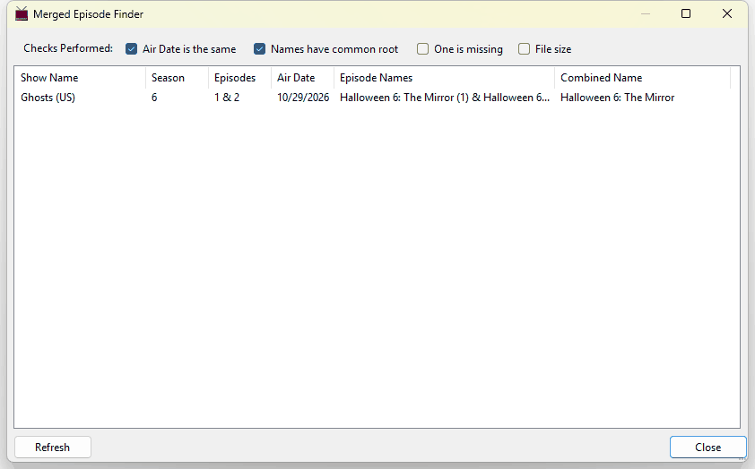

# Find Merged Episodes

Sometimes one video file holds two episodes, for example a double-length opening episode that the data source lists as episodes 1 and 2. TV Rename handles a file like that with a **Merge** rule for the season (see [Edit Season Rules](../../main/my-tv-shows.md#edit-season-rules)). **Tools > Find Merged Episodes...** looks through your library for pairs of episodes that might need one.

When the **Merged Episode Finder** opens it checks every show, with a progress bar along the bottom. Click `Refresh` to check again, and `Close` when you are done.

Each row is a possible pair, showing the **Show Name**, **Season**, **Episodes**, **Air Date**, both **Episode Names**, and a suggested **Combined Name** for the merged episode.

## Checks Performed

The tick boxes at the top narrow the list down. A pair is listed only if it passes every ticked check:

| Check                      | A pair passes when...                                                                                                                                                                                         |
| -------------------------- | ------------------------------------------------------------------------------------------------------------------------------------------------------------------------------------------------------------- |
| **Air Date is the same**   | Both episodes first aired on the same day. Every pair has to pass this, so it can't be unticked.                                                                                                              |
| **Names have common root** | The two episode names are the same length and start the same way for more than half of their length, for example "The Mirror (1)" and "The Mirror (2)". Names that only share the word "Episode" don't count. |
| **One is missing**         | You have a file for one of the two episodes but not the other.                                                                                                                                                |
| **File size**              | The file you have is much longer than the other videos in its folder (its running time is more than 1.4 times their average).                                                                                 |

The checks build on each other. Ticking **File size** also ticks the two checks before it, and ticking **One is missing** also ticks **Names have common root**. Unticking a check also unticks the ones after it.

With all of them ticked you see the strongest candidates. Untick some to see more possibilities. With only **Air Date is the same** ticked you see every pair of episodes that aired on the same day, which is common when a show releases two or more episodes at once.

Seasons where every episode has the same air date, such as a whole season released at once, are not checked.


Any **Merge Rules** that are created can be viewed and edited at [#edit-season-rules](../../main/my-tv-shows.md#edit-season-rules "mention")


## Right-click options

Right-click a row to see:

* `Episode Guide`: closes the finder and shows the episode in the **TV Shows** tab.
* `Force Refresh`: downloads the show's information again.
* `Edit TV Show`: opens the show's settings.
* `Edit Season` followed by the season number: opens the **Edit Season** window, where the season's rules are kept.
* `Add Rule`: adds a Merge rule for the two episodes to that season and removes the row from the list.
