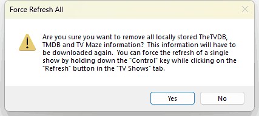

# Force Refresh All

**Tools > Force Refresh All** throws away all the show and movie information TV Rename has downloaded from TheTVDB, TMDB and TVmaze, so that it can be downloaded again. Use it if the information in TV Rename looks wrong or out of date for many shows, and refreshing them one at a time hasn't helped.

Your shows and movies and their settings are kept. Only the downloaded information is replaced. None of your video files or folders are touched.

TV Rename asks you to confirm first:

* `Yes` removes the stored information straight away. If [Options > Automatic Background Download](../options-menu/automatic-background-download.md) is ticked, a fresh download starts about a second later. If it isn't ticked, use [Tools > Background Download Now](background-download-now.md) to download the information again. With a large library the download can take some time, and until it finishes the show details and the **Schedule** tab will be incomplete.
* `No` leaves everything as it was.


**READ IT CAREFULLY AND PAY ATTENTION**. If you click `Yes` there's no going back: all the information TV Rename has stored from TheTVDB, TMDB and TVmaze is **DELETED** and has to be downloaded again. Make sure you are online before you do.


To refresh just one show, select it in the **TV Shows** tab and hold down the Ctrl key while clicking `Refresh`, or right-click the show and choose `Force Refresh`.

If TV Rename is busy downloading updates from the data sources you will see "Can't refresh until background download is complete". Wait until the download shown on the right-hand side of the [status bar](../../main/other.md#the-status-bar) has finished, then try again.


This refreshes the show and movie information only. To refresh image files, see [Force Refresh All Images](force-refresh-images.md).

